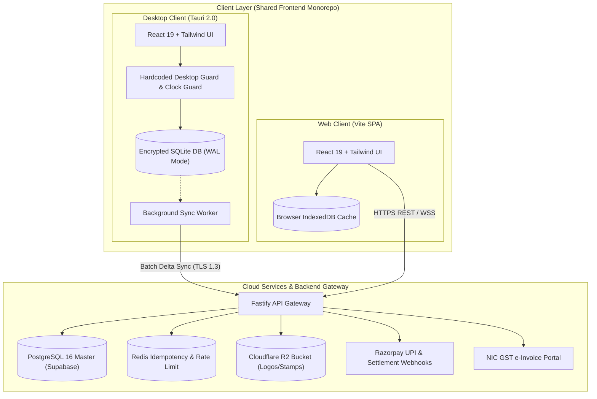

# BillPulse Pro — Engineering Design & Architecture Document

[](README.md)
[](README.md)
[](README.md)
[](https://v2.tauri.app/)
[](https://fastify.dev/)
[](https://tutorial.gst.gov.in/)
[](LICENSE)

---

### Document Metadata

| Attribute | Specification |
| :--- | :--- |
| **Document Version** | `1.0` |
| **Classification** | `Internal — Engineering, Architecture & Product` |
| **Status** | `Production Blueprint` |
| **System Codebase** | Shared Monorepo (`Desktop Offline Engine` + `Web Cloud Engine`) |
| **Primary Target Hardware** | Low-spec Windows 7/10/11 PCs (2 GB–4 GB RAM, Dual-Core) & Modern Desktops |
| **Compliance Standard** | Indian GST Act, CBIC Rules & NIC e-Invoicing JSON Schema |

---

## Document Outline

* [1. Executive Summary & Product Vision](#1-executive-summary--product-vision)
  * [1.1 What the Platform Is](#11-what-the-platform-is)
  * [1.2 Target Users & Hardware Profiles](#12-target-users--hardware-profiles)
  * [1.3 Billing & Operational Lifecycle Coverage](#13-billing--operational-lifecycle-coverage)
  * [1.4 Core Design Philosophy](#14-core-design-philosophy)
* [2. System Architecture Overview](#2-system-architecture-overview)
  * [2.1 High-Level Dual-Runtime Architecture](#21-high-level-dual-runtime-architecture-desktop-offline--web-cloud)
  * [2.2 Architectural Pattern & Tech Stack Matrix](#22-architectural-pattern--tech-stack-matrix)
  * [2.3 Deployment & Storage Architecture](#23-deployment--storage-architecture-where-databases-live)
* [3. Core Modules & Feature Design](#3-core-modules--feature-design)
  * [3.1 Module Map](#31-module-map)
  * [3.2 Auth, Device Binding & Merchant Tenant Management](#32-auth-device-binding--merchant-tenant-management)
  * [3.3 Express POS & GST Invoice Builder (F4 Workflow)](#33-express-pos--gst-invoice-builder-f4-workflow)
  * [3.4 Mandatory Monthly Prefix (YYYYMM) Numbering Engine](#34-mandatory-monthly-prefix-yyyymm-numbering-engine)
  * [3.5 Hardcoded Offline License & 7-Day Post-Month Grace Lock Engine](#35-hardcoded-offline-license--7-day-post-month-grace-lock-engine)
  * [3.6 Offline-to-Cloud Delta Sync & Conflict Resolution Engine](#36-offline-to-cloud-delta-sync--conflict-resolution-engine)
  * [3.7 Micro-Billing Wallet (₹0.50 / ₹1.00) & Monthly Subscription Engine](#37-micro-billing-wallet-050--100--monthly-subscription-engine)
  * [3.8 Zero-Code Logo, Stamp & Brand Customization Studio (F7)](#38-zero-code-logo-stamp--brand-customization-studio-f7)
  * [3.9 Visual Product Catalog & Inventory Ledger (F6)](#39-visual-product-catalog--inventory-ledger-f6)
  * [3.10 Party Khata, Receivables & Reconciliation Engine (F5)](#310-party-khata-receivables--reconciliation-engine-f5)
* [4. Database Architecture, Schemas & Sync Protocols](#4-database-architecture-schemas--sync-protocols)
  * [4.1 Local Desktop Storage vs. Cloud Master Storage](#41-local-desktop-storage-vs-cloud-master-storage)
  * [4.2 Complete Relational Database Schema (SQLite & PostgreSQL)](#42-complete-relational-database-schema-sqlite--postgresql)
  * [4.3 Offline Sync Payload Format & State Machine](#43-offline-sync-payload-format--state-machine)
  * [4.4 Third-Party Integrations & API Matrix](#44-third-party-integrations--api-matrix)
* [5. Hardcoded Desktop Guard & Anti-Tamper Design](#5-hardcoded-desktop-guard--anti-tamper-design)
  * [5.1 Offline Rule Specification & State Transitions](#51-offline-rule-specification--state-transitions)
  * [5.2 Monotonic Clock Guard (Preventing OS Clock Rollback)](#52-monotonic-clock-guard-preventing-os-clock-rollback)
  * [5.3 Hardcoded Desktop Verification Algorithm](#53-hardcoded-desktop-verification-algorithm)
* [6. Print, PDF & Thermal Export Engine Design](#6-print-pdf--thermal-export-engine-design)
  * [6.1 Dual Rendering Pipeline (A4/A5 PDF vs. ESC/POS Thermal)](#61-dual-rendering-pipeline-a4a5-pdf-vs-escpos-thermal)
  * [6.2 Custom Branding, QR & Signatory Stamp Injection](#62-custom-branding-qr--signatory-stamp-injection)
  * [6.3 Legacy Hardware Print Optimization (2 GB RAM Systems)](#63-legacy-hardware-print-optimization-2-gb-ram-systems)
* [7. Infrastructure, Scalability & Cost Estimates](#7-infrastructure-scalability--cost-estimates)
  * [7.1 Cloud Infrastructure Topology](#71-cloud-infrastructure-topology)
  * [7.2 Legacy PC Performance Budget vs. Modern Systems](#72-legacy-pc-performance-budget-vs-modern-systems)
  * [7.3 Monthly Cloud & API Cost Estimation Model](#73-monthly-cloud--api-cost-estimation-model)
* [8. Security, Compliance & GST Readiness](#8-security-compliance--gst-readiness)
  * [8.1 Data Encryption (At Rest & In Transit)](#81-data-encryption-at-rest--in-transit)
  * [8.2 Payment Security & Webhook Verification](#82-payment-security--webhook-verification)
  * [8.3 Indian GST & NIC e-Invoicing Compliance](#83-indian-gst--nic-e-invoicing-compliance)
* [Appendix A: Recommended Build Order & Day-by-Day Timeline (35 Working Days)](#appendix-a-recommended-build-order--day-by-day-timeline-35-working-days)
* [Appendix B: Key Design Decisions & Architectural Trade-offs](#appendix-b-key-design-decisions--architectural-trade-offs)
* [Appendix C: Glossary](#appendix-c-glossary)
* [Local Quickstart & Test Verification](#local-quickstart--test-verification)

---

## 1. Executive Summary & Product Vision

### 1.1 What the Platform Is

**BillPulse Pro** is an ultra-lightweight, high-speed billing, invoicing, and accounting platform engineered to replace complex, legacy accounting software with a modern, visual, one-click, keyboard-accelerated workflow. The platform operates across two synchronized runtimes built from a single shared codebase:

1. **Desktop Application (Offline-First Engine):** Packaged via [Tauri 2.0](https://v2.tauri.app/) (with an [Electron](https://electronjs.org/) fallback option) with an embedded [SQLite](https://www.sqlite.org/) local database in Write-Ahead Logging (WAL) mode and a compiled **Hardcoded Offline License Guard**. It functions reliably with zero internet connectivity, automatically prefixes every invoice with the active billing month (`YYYYMM`), allows up to **7 days of offline grace operation** after a calendar month ends, blocks billing if internet remains disconnected beyond 7 days post-month-end, and upon reconnection automatically syncs queued bills and checks pending dues before unlocking.
2. **Web Application (Cloud-Native Engine):** Built with [React 19](https://react.dev/), [Vite](https://vite.dev/), and [Tailwind CSS](https://tailwindcss.com/), connected in real time to a cloud [PostgreSQL](https://www.postgresql.org/) database via [Supabase](https://supabase.com/). Requires active internet connectivity and provides instant multi-device access to synced desktop and web invoices.

---

### 1.2 Target Users & Hardware Profiles

| User Segment | Typical Hardware Environment | Connectivity Profile | Primary Billing Mode |
| :--- | :--- | :--- | :--- |
| **Retail Counters, Kirana & Agro Stores** | Legacy Windows 7/10 PCs (2 GB–4 GB RAM, Dual-Core CPU) + USB Thermal Printer with [Tauri 2.0](https://v2.tauri.app/) | Intermittent / Offline for days at a time | **₹0.50** per Order Bill (Compact Thermal Receipt) |
| **B2B Wholesalers, Distributors & Traders** | Standard Desktop PCs (4 GB–8 GB RAM) + A4 Laser/Inkjet Printer with [SQLite](https://www.sqlite.org/) local ledger | Hybrid (Offline during peak hours, syncs daily) | **₹1.00** per Tax Invoice (Full GST Invoice with Logo & Stamp) |
| **Multi-Branch Enterprises & Franchises** | Modern Laptops, Tablets & Browser Terminals (8 GB+ RAM) via [React](https://react.dev/) Web App | Always-On Broadband / 4G / 5G | **₹299 / Month** Unlimited (Cloud Web + Multi-Terminal Sync) |

---

### 1.3 Billing & Operational Lifecycle Coverage

| Lifecycle Stage | Traditional Accounting Pain Point | BillPulse Pro Automated Workflow |
| :--- | :--- | :--- |
| **1. Brand & Shop Setup** | Requires custom scripting or complex configuration just to place a logo or stamp on an invoice | Drag-and-drop image upload (`F7`) compresses logos and stamps locally and saves to [Cloudflare R2](https://www.cloudflare.com/products/r2/) with live WYSIWYG preview |
| **2. Daily Billing (`F4`)** | Cryptic text-only voucher screens with steep learning curves | Split-screen visual POS + live printable invoice sheet with 1-click item pills and `F4`–`F8` hotkeys |
| **3. Month Rollover** | Manual voucher series reconfiguration every month or financial year | Automatic `PREFIX-YYYYMM-XXXX` numbering (e.g., `INV-202611-0001` rolling over to `INV-202612-0001`) |
| **4. Offline Operation** | Cloud-only apps crash offline; pure desktop apps lack cloud backup and subscription control | Local [SQLite](https://www.sqlite.org/) queue stores bills offline; hardcoded guard enforces the 7-day post-month grace limit |
| **5. Reconnect & Settlement** | Manual export/import of offline vouchers and manual license renewal calls | Auto-syncs offline queue on reconnect; checks [Razorpay](https://razorpay.com/) dues (₹0.50/₹1.00 or monthly) and unlocks immediately if `due == ₹0.00` |

---

### 1.4 Core Design Philosophy

* **Ultra-Fast Keyboard-First Workflow:** Preserve rapid keyboard-only data entry (`F4` New Bill, `F5` Invoice Register, `F6` Catalog, `F7` Branding, `Ctrl+P` Print) while eliminating cryptic accounting terminology in favor of a clean, responsive visual interface built with [Tailwind CSS](https://tailwindcss.com/).
* **Featherweight Footprint for Old PCs:** Avoid bloated runtime processes; target `< 60 MB RAM` usage on desktop using [Tauri 2.0](https://v2.tauri.app/) and native [SQLite](https://www.sqlite.org/) queries executing in `< 2 ms`.
* **Micro-Monetization Built Into the Core:** Every invoice generated is tagged with its billing tier (₹0.50 Order Bill, ₹1.00 Tax Invoice, or Monthly Plan) inside both the local tamper-evident ledger and the cloud billing ledger.

---

## 2. System Architecture Overview

### 2.1 High-Level Dual-Runtime Architecture (Desktop Offline + Web Cloud)

```
================================================================================
                    CLIENT LAYER (SHARED UI CODEBASE)
================================================================================
  [Desktop App: Tauri 2.0 / Electron]             [Web App: React + Vite SPA]
  ├── UI: React + Tailwind CSS                    ├── UI: React + Tailwind CSS
  ├── Local DB: Encrypted SQLite (WAL mode)       ├── Local Cache: IndexedDB
  ├── Hardcoded Guard: Rust/Node Native Binary    └── Network Policy: Online-Only
  │   ├── Enforces YYYYMM Month Prefix
  │   ├── Monotonic Clock Anti-Tamper Check
  │   └── Blocks if Month Exceeded + >7d Offline
  └── Background Delta Sync Worker
           │
           │
           └──────────────────────┬──────────────────────┘
                                  │
                                  │ HTTPS / TLS 1.3 (JSON Delta Batches)
                                  ▼
================================================================================
                 API GATEWAY & CORE BACKEND (FASTIFY)
================================================================================
  [Fastify / Node.js API Cluster]
  ├── Auth & Device Registry Middleware (JWT + Hardware Fingerprint)
  ├── Batch Sync Ingestion Service (/api/v1/sync/batch)
  ├── License & Grace Period Evaluator (/api/v1/license/verify)
  ├── Micro-Billing Metering Engine (Rs. 0.50 / Rs. 1.00 / Monthly Ledger)
  └── Webhook Listener (/api/v1/webhooks/razorpay)
           │
           ├──► [PostgreSQL Master DB (Supabase)] ──► Invoices, Ledgers, Tenants
           ├──► [Redis Cache & Rate Limiter] ──────► Session Locks, Idempotency
           ├──► [Cloudflare R2 Object Storage] ────► Logos, Stamps, Item Photos
           └──► [External Integrations]
                ├── Razorpay Payment Gateway & UPI QR (Dues Settlement)
                └── NIC GST e-Invoice API (IRN & Signed QR Generation)
```



---

### 2.2 Architectural Pattern & Tech Stack Matrix

| Architectural Layer | Recommended Technology | Official Documentation | Rationale for Choice |
| :--- | :--- | :--- | :--- |
| **Desktop App Shell** | Tauri 2.0 (Primary) or Electron (Fallback) | [Tauri 2.0](https://v2.tauri.app/) / [Electron](https://electronjs.org/) | [Tauri 2.0](https://v2.tauri.app/) compiles the offline license guard into native binary code (tamper-resistant) and produces an ~8 MB installer using 80% less RAM than Electron. |
| **Shared Frontend UI** | React 19 + Vite + Tailwind CSS | [React](https://react.dev/) / [Vite](https://vite.dev/) / [Tailwind CSS](https://tailwindcss.com/) | Single UI codebase powers both Desktop and Web Apps with zero layout shift and sub-second startup via [Vite](https://vite.dev/). |
| **Desktop Local Database**| SQLite 3 (WAL Mode + SQLCipher) | [SQLite](https://www.sqlite.org/) / [SQLite Browser](https://sqlitebrowser.org/) | Single-file, ACID-compliant transactional database on the desktop PC; survives sudden power loss and requires zero background database server installation. |
| **Browser Local Cache** | IndexedDB | [IndexedDB API](https://developer.mozilla.org/en-US/docs/Web/API/IndexedDB_API) | Caches product catalog items, logos, and customer party lists inside the browser for instant autocomplete. |
| **Backend API Framework**| Fastify (Node.js TypeScript) | [Fastify](https://fastify.dev/) | Low-overhead schema-validated JSON server capable of processing 30,000+ sync requests per second. |
| **Cloud Master Database**| PostgreSQL 16 (via Supabase) | [PostgreSQL](https://www.postgresql.org/) / [Supabase](https://supabase.com/database) | Multi-tenant relational database with Row-Level Security (RLS) isolating each merchant's invoices, customers, and billing ledger. |
| **In-Memory Queue & Cache**| Redis | [Redis](https://redis.io/) | Stores idempotency keys during offline batch syncs so retried network requests never duplicate an invoice. |
| **Logo & Image Storage** | Cloudflare R2 | [Cloudflare R2](https://www.cloudflare.com/products/r2/) | S3-compatible object storage with zero egress fees when syncing company logos, rubber stamps, and item images across terminals. |
| **Payments & Micro-Billing**| Razorpay Payment Gateway & UPI | [Razorpay](https://razorpay.com/) / [Razorpay UPI](https://razorpay.com/upi-payment-gateway-india/) | Supports instant dynamic UPI QR codes, Payment Links, and webhooks to settle ₹0.50 / ₹1.00 invoice dues or ₹299/month subscriptions. |

---

### 2.3 Deployment & Storage Architecture (Where Databases Live)

| Data Asset | Desktop App Storage Location (Offline-Capable) | Web App Storage Location (Cloud Live) | Sync Mechanism When Internet Connects |
| :--- | :--- | :--- | :--- |
| **Invoices & Line Items** | Local encrypted [SQLite](https://www.sqlite.org/) file at `C:\ProgramData\BillPulse\data\ledger.sqlite3` (Windows) or `~/.local/share/billpulse/ledger.sqlite3` (Linux/macOS) | Central [PostgreSQL](https://www.postgresql.org/) `invoices` & `invoice_line_items` tables on [Supabase](https://supabase.com/) | Desktop background worker pushes all rows where `sync_status = 'offline_queued'` via `POST /api/v1/sync/batch` and marks them `synced`. |
| **Company Logo, Stamp & Product Images** | Local disk folder `C:\ProgramData\BillPulse\assets\` + cached Data URI inside [SQLite](https://www.sqlite.org/) for instant offline printing | [Cloudflare R2](https://www.cloudflare.com/products/r2/) bucket (`r2://billpulse-assets/{tenant_id}/`) with CDN URLs stored in [PostgreSQL](https://www.postgresql.org/) | Uploaded images are compressed to `< 150 KB` WebP/PNG on the client and uploaded to [Cloudflare R2](https://www.cloudflare.com/products/r2/) when online. |
| **License State & 7-Day Grace Counter** | Signed binary state file `license.guard` + `merchant_profile` table inside encrypted [SQLite](https://www.sqlite.org/) | `merchant_profile` & `billing_transactions` tables in [PostgreSQL](https://www.postgresql.org/) | Upon internet connection, desktop calls `POST /api/v1/license/verify`; if `pending_dues == 0`, server issues a fresh signed JWT resetting the 7-day grace window. |

---

## 3. Core Modules & Feature Design

### 3.1 Module Map

```
BillPulse Pro Platform
├── 3.2 Auth, Device Binding & Tenant Management
├── 3.3 Express POS & GST Invoice Builder (F4)
├── 3.4 Mandatory Monthly Prefix (YYYYMM) Numbering Engine
├── 3.5 Hardcoded Offline License & 7-Day Grace Lock Engine
├── 3.6 Offline-to-Cloud Delta Sync Engine (F5)
├── 3.7 Micro-Billing Wallet (Rs. 0.50 / Rs. 1.00) & Monthly Plan Engine
├── 3.8 Zero-Code Logo, Stamp & Brand Studio (F7)
├── 3.9 Visual Product Catalog & Inventory Manager (F6)
└── 3.10 Party Khata, Receivables & GST Export Engine
```

---

### 3.2 Auth, Device Binding & Merchant Tenant Management

* **Merchant Onboarding:** Merchants register using their mobile phone number (OTP verified via [Supabase Auth](https://supabase.com/auth)), business trading name, and optional 15-digit GSTIN.
* **Desktop Terminal Binding:** Each desktop installation generates a persistent `device_id` (cryptographic hardware UUID hash) and registers an assigned 2-character terminal code (e.g., `D1`, `D2`). This guarantees that offline invoices generated on Desktop 1 (`INV-202611-D1-0001`) never collide with invoices generated on Desktop 2 or Web App (`INV-202611-W1-0001`).

---

### 3.3 Express POS & GST Invoice Builder (F4 Workflow)

* **Split-Screen Speed Architecture:** Left pane provides keyboard-first entry (`Tab`/`Enter` navigation across Party Name, Phone, GSTIN, Item Search, Qty, Rate, GST %, and Discount); right pane renders a real-time 1:1 printable invoice sheet.
* **Automatic Tax Calculation:** Automatically computes intrastate (CGST + SGST) or interstate (IGST) tax splits across standard Indian GST slabs (0%, 5%, 12%, 18%, 28%) compliant with the [Digital India GST e-Invoice System](https://www.digitalindia.gov.in/initiative/gst-e-invoice-system/).

---

### 3.4 Mandatory Monthly Prefix (YYYYMM) Numbering Engine

* **Format Specification:** Every invoice number strictly follows:
  * Single-terminal setups: `{SERIES_PREFIX}-{YYYYMM}-{SEQ}` (e.g. `INV-202611-0001`)
  * Multi-terminal setups: `{SERIES_PREFIX}-{YYYYMM}-{DEVICE_CODE}-{SEQ}` (e.g. `INV-202611-D1-0001`)
* **Automatic Month Rollover:** When the system date enters a new calendar month (e.g., transitioning from `2026-11` to `2026-12`), the numbering engine automatically initializes the new month prefix (`INV-202612-0001`) and flags the previous month (`2026-11`) as *Month Exceeded — Pending Settlement Verification*.

---

### 3.5 Hardcoded Offline License & 7-Day Post-Month Grace Lock Engine

| Scenario | Internet Status | Month Exceeded? | Offline Days Since Month-End | Pending Payment Left? | System Action |
| :--- | :--- | :--- | :--- | :--- | :--- |
| **Normal Online Operation** | **ONLINE** | `false` | 0 days | Accrued in cycle | **Allowed:** Invoices save locally and sync live to [PostgreSQL](https://www.postgresql.org/). |
| **Mid-Month Offline Operation** | **OFFLINE** | `false` | 0 days | Accrued locally | **Allowed:** Works 100% offline using [SQLite](https://www.sqlite.org/); queues bills as `offline_queued`. |
| **Post-Month Grace Window (Days 1–7)** | **OFFLINE** | `true` | 1 to 7 days | Unverified offline | **Allowed with Warning Banner:** Merchant can continue billing offline for up to 7 days after month-end; banner displays remaining grace days. |
| **Post-Month Grace Exceeded (>7 Days)** | **OFFLINE** | `true` | > 7 days (Day 8+) | Unverified offline | **HARD BLOCKED:** Hardcoded lock screen blocks new invoice creation until internet is connected. |
| **Reconnected — Payment Pending** | **ONLINE** | `true` | Reset to 0 | > ₹0.00 Left | **Syncs & Prompts Payment:** Automatically syncs queued offline invoices first, then displays the [Razorpay](https://razorpay.com/) settlement modal for the remaining balance. |
| **Reconnected — No Payment Left** | **ONLINE** | `true` | Reset to 0 | ₹0.00 Left | **Unlocks Immediately:** Issues a new monthly license token and unlocks full desktop functionality. |
| **Web Application Offline** | **OFFLINE** | Any | Any | Any | **Blocked in Browser:** Displays prompt to reconnect internet or switch to the Offline Desktop App. |

---

### 3.6 Offline-to-Cloud Delta Sync & Conflict Resolution Engine

```
[Offline Desktop Invoice Created]
       │
       ▼
[Saved to Local SQLite: sync_status = 'offline_queued', fee_accrued = 0.50]
       │
       ▼ (Internet Reconnect Detected via Socket / Network Ping)
[Sync Worker Reads Batch of 'offline_queued' Rows (Max 100 per batch)]
       │
       ▼
[POST /api/v1/sync/batch with Idempotency UUIDs]
       │
       ├──► [Server Inserts into PostgreSQL & Updates Merchant Billing Balance]
       │
       ▼
[Server Returns { synced_ids: [...], pending_dues_inr: 42.50, license_status }]
       │
       ├──► If pending_dues_inr > 0 AND month_exceeded: Show Razorpay Payment Modal
       └──► If pending_dues_inr == 0: Unlock New Month Cycle & Mark Local Rows 'synced'
```

```mermaid
sequenceDiagram
    autonumber
    participant Desktop as Desktop App (Tauri / SQLite)
    participant Worker as Background Sync Worker
    participant Fastify as Fastify Cloud API
    participant PG as PostgreSQL (Supabase)
    participant Razorpay as Razorpay Gateway

    Desktop->>Desktop: Create invoice offline (INV-202611-D1-0001)
    Desktop->>Desktop: Write to SQLite (sync_status = 'offline_queued')
    Note over Desktop,Worker: Internet Connection Restored
    Worker->>Desktop: Query invoices WHERE sync_status = 'offline_queued' (Limit 100)
    Worker->>Fastify: POST /api/v1/sync/batch (UUIDs, line items, terminal_code)
    Fastify->>PG: BEGIN TRANSACTION; Upsert invoices & update dues
    PG-->>Fastify: Commit OK (New pending dues calculated)
    Fastify-->>Worker: HTTP 200 { synced_ids, pending_dues_inr, license_status }
    Worker->>Desktop: UPDATE invoices SET sync_status = 'synced' WHERE uuid IN (...)

    alt Pending Dues > 0 AND Month Exceeded
        Worker->>Desktop: Trigger Razorpay Settlement Modal
        Desktop->>Razorpay: Merchant pays outstanding fee
        Razorpay->>Fastify: Webhook (payment.captured)
        Fastify->>PG: Reset pending_dues_paise = 0
        Fastify-->>Desktop: Issue fresh signed license JWT -> Full Unlock
    else Pending Dues == 0
        Worker->>Desktop: Unlock new month immediately
    end
```

---

### 3.7 Micro-Billing Wallet (₹0.50 / ₹1.00) & Monthly Subscription Engine

| Plan Code | Billing Model | Rate | Target Invoice Type | Settlement Mechanism |
| :--- | :--- | :--- | :--- | :--- |
| `PER_ORDER_050` | Micro-Order Rate | **₹0.50** / bill | Compact thermal order bills & cash memos | Deducted from prepaid reserve wallet or accrued into monthly postpaid dues settled via [Razorpay UPI](https://razorpay.com/upi-payment-gateway-india/). |
| `PER_INVOICE_100` | Full Tax Invoice Rate | **₹1.00** / invoice | Full A4/A5 GST Tax Invoices with Logo, HSN & Stamp | Deducted from prepaid reserve wallet or accrued into monthly postpaid dues settled via [Razorpay Payment Gateway](https://razorpay.com/payment-gateway/). |
| `MONTHLY_UNLIMITED` | Flat Monthly Subscription | **₹299** / month | Unlimited Order Bills + Full GST Tax Invoices | Billed monthly via [Razorpay Payment Links](https://razorpay.com/payment-links/) or UPI Autopay. |

---

### 3.8 Zero-Code Logo, Stamp & Brand Customization Studio (F7)

* **Instant Image Picker:** Client-side image compression resizes uploaded company logos and authorized signature/rubber stamp images to `< 150 KB` WebP/PNG, saving them to local [SQLite](https://www.sqlite.org/) (for instant offline rendering) and syncing to [Cloudflare R2](https://www.cloudflare.com/products/r2/).
* **Live Theme & Prefix Configuration:** Customize invoice series prefixes (`INV`, `BILL`, `POS`), brand accent colors, GSTIN headers, bank account details, and merchant UPI IDs.

---

### 3.9 Visual Product Catalog & Inventory Ledger (F6)

* **1-Click Fast Pills:** Frequently sold items appear as visual pills with selling prices, HSN codes, and GST rates for instant cart insertion.
* **Keyboard Search:** Full-text search over items and HSN codes running locally in `< 2 ms` via SQLite indexed queries.

---

### 3.10 Party Khata, Receivables & Reconciliation Engine (F5)

* **Customer Ledger:** Tracks credit balances, unpaid receivables, and payment histories across all cash and credit sales.
* **Instant WhatsApp / SMS Share:** Generates compact invoice summaries with direct payment links for customers.

---

## 4. Database Architecture, Schemas & Sync Protocols

### 4.1 Local Desktop Storage vs. Cloud Master Storage

To guarantee zero data loss and fast performance on older computers, both the local [SQLite](https://www.sqlite.org/) database and the cloud [PostgreSQL](https://www.postgresql.org/) database share mirrored core table structures.

---

### 4.2 Complete Relational Database Schema (SQLite & PostgreSQL)

#### SQLite Local Schema (`packages/database/sqlite/schema.sql`)

```sql
-- 1. MERCHANT PROFILE & HARDCODED LICENSE STATE
CREATE TABLE IF NOT EXISTS merchant_profile (
    tenant_id TEXT PRIMARY KEY,
    company_name TEXT NOT NULL,
    company_address TEXT,
    company_gstin TEXT,
    upi_id TEXT,
    invoice_prefix TEXT NOT NULL DEFAULT 'INV',
    billing_plan TEXT NOT NULL DEFAULT 'PER_ORDER_050', -- 'PER_ORDER_050' | 'PER_INVOICE_100' | 'MONTHLY_UNLIMITED'
    logo_data_uri TEXT,                                 -- Cached locally for offline rendering
    signature_data_uri TEXT,                            -- Cached locally for offline rendering
    active_year_month TEXT NOT NULL,                    -- Format: 'YYYY-MM' (e.g. '2026-11')
    last_synced_at INTEGER NOT NULL,                    -- Unix epoch timestamp (seconds)
    max_seen_timestamp INTEGER NOT NULL,                -- Monotonic clock high-water mark against OS rollback
    pending_dues_paise INTEGER NOT NULL DEFAULT 0,      -- Micro-billing balance in paise (50 = Rs. 0.50, 100 = Rs. 1.00)
    signed_license_jwt TEXT,                            -- Cryptographically signed server license token
    device_id TEXT NOT NULL,                            -- Unique hardware/installation fingerprint hash
    terminal_code TEXT NOT NULL DEFAULT 'D1'            -- Terminal identifier for collision-free numbering
);

-- 2. PRODUCT & SERVICE CATALOG
CREATE TABLE IF NOT EXISTS catalog_items (
    item_id TEXT PRIMARY KEY,
    tenant_id TEXT NOT NULL,
    item_name TEXT NOT NULL,
    hsn_code TEXT,
    selling_rate_paise INTEGER NOT NULL,                -- Stored in paise for precision
    gst_percent REAL NOT NULL DEFAULT 5.0,              -- 0.0, 5.0, 12.0, 18.0, 28.0
    image_data_uri TEXT,
    updated_at INTEGER NOT NULL
);

-- 3. MONTH-PREFIXED INVOICES & OFFLINE SYNC QUEUE
CREATE TABLE IF NOT EXISTS invoices (
    invoice_uuid TEXT PRIMARY KEY,                      -- UUIDv4 for cloud idempotent upsert
    tenant_id TEXT NOT NULL,
    invoice_number TEXT NOT NULL UNIQUE,                -- Format: INV-202611-0001 or INV-202611-D1-0001
    year_month_prefix TEXT NOT NULL,                    -- '202611' (Mandatory YYYYMM prefix)
    invoice_date TEXT NOT NULL,                         -- 'YYYY-MM-DD'
    customer_name TEXT NOT NULL,
    customer_phone TEXT,
    customer_gstin TEXT,
    payment_mode TEXT NOT NULL,                         -- 'CASH', 'UPI', 'CARD', 'CREDIT'
    subtotal_paise INTEGER NOT NULL,
    gst_total_paise INTEGER NOT NULL,
    discount_paise INTEGER NOT NULL DEFAULT 0,
    grand_total_paise INTEGER NOT NULL,
    billing_tier TEXT NOT NULL,                         -- 'PER_ORDER_050', 'PER_INVOICE_100', 'MONTHLY_UNLIMITED'
    platform_fee_paise INTEGER NOT NULL,                -- 50 (Rs. 0.50), 100 (Rs. 1.00), or 0
    sync_status TEXT NOT NULL DEFAULT 'offline_queued', -- 'offline_queued' | 'synced'
    created_at_unix INTEGER NOT NULL
);

-- 4. INVOICE LINE ITEMS
CREATE TABLE IF NOT EXISTS invoice_line_items (
    line_id TEXT PRIMARY KEY,
    invoice_uuid TEXT NOT NULL REFERENCES invoices(invoice_uuid) ON DELETE CASCADE,
    item_name TEXT NOT NULL,
    qty REAL NOT NULL,
    rate_paise INTEGER NOT NULL,
    gst_percent REAL NOT NULL,
    line_total_paise INTEGER NOT NULL
);

CREATE INDEX IF NOT EXISTS idx_invoices_sync_status ON invoices(sync_status);
CREATE INDEX IF NOT EXISTS idx_invoices_year_month ON invoices(year_month_prefix);
CREATE INDEX IF NOT EXISTS idx_invoices_created_at ON invoices(created_at_unix);
CREATE INDEX IF NOT EXISTS idx_catalog_items_tenant ON catalog_items(tenant_id);
CREATE INDEX IF NOT EXISTS idx_line_items_invoice ON invoice_line_items(invoice_uuid);
```

---

#### PostgreSQL Cloud Master Schema (`packages/database/postgres/schema.sql`)

```sql
CREATE EXTENSION IF NOT EXISTS "uuid-ossp";

-- 1. CLOUD MERCHANT PROFILE & BALANCES
CREATE TABLE IF NOT EXISTS merchant_profile (
    tenant_id UUID PRIMARY KEY DEFAULT uuid_generate_v4(),
    company_name VARCHAR(255) NOT NULL,
    company_address TEXT,
    company_gstin VARCHAR(15),
    upi_id VARCHAR(100),
    invoice_prefix VARCHAR(10) NOT NULL DEFAULT 'INV',
    billing_plan VARCHAR(30) NOT NULL DEFAULT 'PER_ORDER_050',
    logo_url TEXT,
    signature_url TEXT,
    active_year_month VARCHAR(7) NOT NULL,
    last_synced_at BIGINT NOT NULL DEFAULT EXTRACT(EPOCH FROM NOW())::BIGINT,
    pending_dues_paise BIGINT NOT NULL DEFAULT 0,
    wallet_balance_paise BIGINT NOT NULL DEFAULT 0,
    created_at TIMESTAMPTZ NOT NULL DEFAULT NOW(),
    updated_at TIMESTAMPTZ NOT NULL DEFAULT NOW()
);

-- 2. REGISTERED TERMINALS
CREATE TABLE IF NOT EXISTS merchant_terminals (
    device_id VARCHAR(128) PRIMARY KEY,
    tenant_id UUID NOT NULL REFERENCES merchant_profile(tenant_id) ON DELETE CASCADE,
    terminal_code VARCHAR(4) NOT NULL,
    terminal_name VARCHAR(100) NOT NULL,
    app_version VARCHAR(20) NOT NULL,
    last_seen_at TIMESTAMPTZ NOT NULL DEFAULT NOW(),
    UNIQUE (tenant_id, terminal_code)
);

-- 3. PRODUCT CATALOG
CREATE TABLE IF NOT EXISTS catalog_items (
    item_id VARCHAR(64) PRIMARY KEY,
    tenant_id UUID NOT NULL REFERENCES merchant_profile(tenant_id) ON DELETE CASCADE,
    item_name VARCHAR(255) NOT NULL,
    hsn_code VARCHAR(10),
    selling_rate_paise BIGINT NOT NULL,
    gst_percent NUMERIC(4,2) NOT NULL DEFAULT 5.00,
    image_url TEXT,
    updated_at BIGINT NOT NULL
);

-- 4. MASTER INVOICES
CREATE TABLE IF NOT EXISTS invoices (
    invoice_uuid UUID PRIMARY KEY,
    tenant_id UUID NOT NULL REFERENCES merchant_profile(tenant_id) ON DELETE CASCADE,
    device_id VARCHAR(128) REFERENCES merchant_terminals(device_id),
    invoice_number VARCHAR(64) NOT NULL,
    year_month_prefix VARCHAR(6) NOT NULL,
    invoice_date DATE NOT NULL,
    customer_name VARCHAR(255) NOT NULL,
    customer_phone VARCHAR(20),
    customer_gstin VARCHAR(15),
    payment_mode VARCHAR(20) NOT NULL,
    subtotal_paise BIGINT NOT NULL,
    gst_total_paise BIGINT NOT NULL,
    discount_paise BIGINT NOT NULL DEFAULT 0,
    grand_total_paise BIGINT NOT NULL,
    billing_tier VARCHAR(30) NOT NULL,
    platform_fee_paise BIGINT NOT NULL,
    sync_status VARCHAR(20) NOT NULL DEFAULT 'synced',
    created_at_unix BIGINT NOT NULL,
    synced_at TIMESTAMPTZ NOT NULL DEFAULT NOW(),
    UNIQUE (tenant_id, invoice_number)
);

-- 5. INVOICE LINE ITEMS
CREATE TABLE IF NOT EXISTS invoice_line_items (
    line_id VARCHAR(64) PRIMARY KEY,
    invoice_uuid UUID NOT NULL REFERENCES invoices(invoice_uuid) ON DELETE CASCADE,
    item_name VARCHAR(255) NOT NULL,
    qty NUMERIC(10,3) NOT NULL,
    rate_paise BIGINT NOT NULL,
    gst_percent NUMERIC(4,2) NOT NULL,
    line_total_paise BIGINT NOT NULL
);

-- 6. MICRO-BILLING TRANSACTION AUDIT LOG
CREATE TABLE IF NOT EXISTS billing_transactions (
    transaction_id UUID PRIMARY KEY DEFAULT uuid_generate_v4(),
    tenant_id UUID NOT NULL REFERENCES merchant_profile(tenant_id) ON DELETE CASCADE,
    amount_paise BIGINT NOT NULL,
    transaction_type VARCHAR(30) NOT NULL,
    razorpay_payment_id VARCHAR(100),
    razorpay_order_id VARCHAR(100),
    status VARCHAR(20) NOT NULL DEFAULT 'SUCCESS',
    notes TEXT,
    created_at TIMESTAMPTZ NOT NULL DEFAULT NOW()
);

CREATE INDEX IF NOT EXISTS idx_cloud_invoices_tenant_month ON invoices(tenant_id, year_month_prefix);
CREATE INDEX IF NOT EXISTS idx_cloud_invoices_created ON invoices(created_at_unix);
CREATE INDEX IF NOT EXISTS idx_cloud_catalog_tenant ON catalog_items(tenant_id);
CREATE INDEX IF NOT EXISTS idx_cloud_line_items_invoice ON invoice_line_items(invoice_uuid);
CREATE INDEX IF NOT EXISTS idx_cloud_billing_tx_tenant ON billing_transactions(tenant_id);

ALTER TABLE merchant_profile ENABLE ROW LEVEL SECURITY;
ALTER TABLE catalog_items ENABLE ROW LEVEL SECURITY;
ALTER TABLE invoices ENABLE ROW LEVEL SECURITY;
ALTER TABLE invoice_line_items ENABLE ROW LEVEL SECURITY;
ALTER TABLE billing_transactions ENABLE ROW LEVEL SECURITY;
```

---

### 4.3 Offline Sync Payload Format & State Machine

```json
{
  "tenant_id": "tenant-demo-001",
  "device_id": "DEV-MOCK-HARDWARE-UUID-9988",
  "terminal_code": "D1",
  "client_timestamp": 1794220800,
  "invoices": [
    {
      "invoice_uuid": "550e8400-e29b-41d4-a716-446655440001",
      "tenant_id": "tenant-demo-001",
      "invoice_number": "INV-202611-D1-0001",
      "year_month_prefix": "202611",
      "invoice_date": "2026-11-09",
      "customer_name": "Ramesh Kumar",
      "customer_phone": "9876543210",
      "customer_gstin": null,
      "payment_mode": "UPI",
      "subtotal_paise": 26500,
      "gst_total_paise": 1325,
      "discount_paise": 0,
      "grand_total_paise": 27825,
      "billing_tier": "PER_ORDER_050",
      "platform_fee_paise": 50,
      "sync_status": "offline_queued",
      "created_at_unix": 1794220800,
      "items": [
        {
          "line_id": "LINE-101-1",
          "invoice_uuid": "550e8400-e29b-41d4-a716-446655440001",
          "item_name": "Basmati Rice Premium (1kg)",
          "qty": 1.0,
          "rate_paise": 12000,
          "gst_percent": 5.0,
          "line_total_paise": 12600
        }
      ]
    }
  ]
}
```

---

### 4.4 Third-Party Integrations & API Matrix

| Integration Domain | Provider / Standard | Integration Method | Pricing / Cost Impact |
| :--- | :--- | :--- | :--- |
| **UPI & Fee Settlement** | [Razorpay UPI](https://razorpay.com/upi-payment-gateway-india/) & [Razorpay Payment Gateway](https://razorpay.com/payment-gateway/) | REST Orders API + Dynamic QR + Signed Webhooks (`x-razorpay-signature`) | Standard merchant fees per [Razorpay Pricing](https://razorpay.com/pricing/); batching ₹0.50/₹1.00 fees into ₹50+ wallet top-ups or monthly settlements avoids micro-transaction gateway minimums. |
| **Cloud Database & Auth** | [Supabase](https://supabase.com/) ([PostgreSQL](https://www.postgresql.org/) + [Supabase Auth](https://supabase.com/auth)) | HTTPS REST / Connection Pooler | Free tier for initial launch; Pro tier starts at $25/month per [Supabase Pricing](https://supabase.com/pricing). |
| **Logo & Image CDN** | [Cloudflare R2](https://www.cloudflare.com/products/r2/) | S3-Compatible Presigned Upload URLs | 10 GB/month free storage and zero egress bandwidth charges. |
| **B2B GST e-Invoicing** | [NIC GST e-Invoice Portal](https://www.nic.gov.in/project/gst-e-invoice/) | GSP REST API (`einvoice1.gst.gov.in` JSON Schema per [GST e-Invoice Overview](https://tutorial.gst.gov.in/downloads/news/e_invoice_overview.pdf)) | Optional add-on for B2B merchants generating official IRN & signed QR codes. |

---

## 5. Hardcoded Desktop Guard & Anti-Tamper Design

### 5.1 Offline Rule Specification & State Transitions

1. **Active Month Operation:** During the current calendar month (`YYYY-MM`), the desktop app functions fully offline. Invoices are stored in SQLite with `sync_status = 'offline_queued'`.
2. **7-Day Grace Window:** When the month ends, the app allows up to 7 calendar days of offline operation with a non-blocking warning banner showing remaining grace days.
3. **Day 8+ Hard Block:** If disconnected for $> 7$ days after month-end, the app blocks all new invoice creation with an anti-tamper lock screen until internet is connected.
4. **Reconnection Verification:** Upon reconnection, queued bills sync first; if any outstanding dues exist from the closed month, the payment modal appears. Once cleared, full access unlocks immediately.

---

### 5.2 Monotonic Clock Guard (Preventing OS Clock Rollback)

Because the Desktop App runs offline on user-controlled Windows PCs, a user might attempt to bypass the 7-day post-month offline lock by rolling back their Windows system clock. To prevent this:

* Every time the app launches or generates an invoice, it compares the current OS timestamp (`now_unix`) against `max_seen_timestamp` stored in the encrypted SQLite database.
* If `now_unix < max_seen_timestamp - 300` (clock moved backward by more than 5 minutes), the Hardcoded Guard immediately flags `CLOCK_TAMPER_DETECTED` and requires an online NTP/Server sync before allowing new invoices.
* Otherwise, `max_seen_timestamp` is updated to `MAX(max_seen_timestamp, now_unix)`.

---

### 5.3 Hardcoded Desktop Verification Algorithm

```typescript
// Compiled into the Desktop Main Process / Native Rust Guard
// packages/desktop-guard/src/guard.ts

import type { MerchantProfile, GuardEvaluationResult } from '@billpulse/shared';

export const MAX_GRACE_DAYS_POST_MONTH = 7;
export const SECONDS_PER_DAY = 86400;
export const CLOCK_ROLLBACK_TOLERANCE_SECONDS = 300; // 5 minutes

export function getEndOfMonthUnix(yearMonth: string): number {
  const [yearStr, monthStr] = yearMonth.split('-');
  const year = parseInt(yearStr, 10);
  const month = parseInt(monthStr, 10);
  const endOfMonth = new Date(Date.UTC(year, month, 0, 23, 59, 59, 999));
  return Math.floor(endOfMonth.getTime() / 1000);
}

export function verifyDesktopGuard(
  profile: MerchantProfile,
  nowUnix: number,
  isInternetConnected: boolean
): GuardEvaluationResult {
  // 1. Anti-Tamper System Clock Check
  if (nowUnix < profile.max_seen_timestamp - CLOCK_ROLLBACK_TOLERANCE_SECONDS) {
    return {
      allowed: false,
      code: 'CLOCK_TAMPERED_CONNECT_INTERNET',
      message: 'System clock rollback detected. Connect to internet to re-verify time.'
    };
  }

  const d = new Date(nowUnix * 1000);
  const currentYearMonth = `${d.getUTCFullYear()}-${String(d.getUTCMonth() + 1).padStart(2, '0')}`;
  const isMonthExceeded = currentYearMonth > profile.active_year_month;

  // 2. Compute days elapsed since the active billing month ended
  const activeMonthEndUnix = getEndOfMonthUnix(profile.active_year_month);
  const referenceTimestamp = Math.max(profile.last_synced_at, activeMonthEndUnix);
  const offlineDaysAfterMonthEnd = isMonthExceeded
    ? Math.floor(Math.max(0, nowUnix - referenceTimestamp) / SECONDS_PER_DAY)
    : 0;

  // 3. Offline Evaluation: Allow up to 7 days after month-end; block on Day 8+
  if (!isInternetConnected) {
    if (isMonthExceeded && offlineDaysAfterMonthEnd > MAX_GRACE_DAYS_POST_MONTH) {
      return {
        allowed: false,
        code: 'BLOCKED_OFFLINE_OVER_7_DAYS',
        offlineDays: offlineDaysAfterMonthEnd,
        pendingDuesINR: profile.pending_dues_paise / 100,
        message: 'Offline grace period exceeded (>7 days). Connect internet to continue billing.'
      };
    }

    const remainingGraceDays = isMonthExceeded
      ? Math.max(0, MAX_GRACE_DAYS_POST_MONTH - offlineDaysAfterMonthEnd)
      : undefined;

    return {
      allowed: true,
      code: 'OFFLINE_ALLOWED',
      remainingGraceDays,
      offlineDays: isMonthExceeded ? offlineDaysAfterMonthEnd : 0
    };
  }

  // 4. Online Reconnection Evaluation: Check if pending payment is left for exceeded month
  if (isMonthExceeded && profile.pending_dues_paise > 0) {
    return {
      allowed: false,
      code: 'PAYMENT_DUE_ON_RECONNECT',
      pendingDuesINR: profile.pending_dues_paise / 100,
      message: 'Previous month settlement pending. Settle via Razorpay to unlock.'
    };
  }

  // 5. All Clear: Roll over active_year_month and unlock full desktop access
  const nextPrefix = `${profile.invoice_prefix}-${currentYearMonth.replace('-', '')}-`;
  return {
    allowed: true,
    code: 'UNLOCKED_AND_VERIFIED',
    nextPrefix
  };
}
```

---

## 6. Print, PDF & Thermal Export Engine Design

### 6.1 Dual Rendering Pipeline (A4/A5 PDF vs. ESC/POS Thermal)

| Print Format | Target Billing Tier | Rendering Technology | Latency on Legacy 2 GB PC |
| :--- | :--- | :--- | :--- |
| **Compact Thermal Receipt (58mm / 80mm)** | **₹0.50** Order Bill | Direct ESC/POS raw byte stream over USB/Serial port or lightweight monochrome HTML layout | **< 50 ms** (Instant feed, zero PDF spooler overhead) |
| **Full GST Tax Invoice (A4 / A5)** | **₹1.00** Tax Invoice & Monthly Plan | Native OS Webview `@media print` CSS vector layout with embedded Logo, HSN Summary & Signature Stamp | **< 300 ms** |

---

### 6.2 Custom Branding, QR & Signatory Stamp Injection

* **Dynamic UPI QR Code:** Generates dynamic UPI payment QR codes (`upi://pay?pa=...&am=...&pn=...&tr=...`) directly on thermal receipts and A4 sheets for instant cashier collection.
* **Vector Watermarking:** Renders shop signature and rubber stamps seamlessly without pixelation on high-DPI laser printers.

---

### 6.3 Legacy Hardware Print Optimization (2 GB RAM Systems)

* **Zero Heavy Headless Browsers:** Instead of spawning a separate headless browser instance to generate PDFs (which consumes 300+ MB RAM), BillPulse Pro uses native CSS `@media print` rules inside the existing [Tauri 2.0](https://v2.tauri.app/) window and direct USB ESC/POS byte commands for thermal printers.
* **Pre-Scaled Image Assets:** Uploaded logos and signature stamps are downscaled once at upload time to $300 \times 300\text{ px}$ so rendering an invoice uses negligible memory.

---

## 7. Infrastructure, Scalability & Cost Estimates

### 7.1 Cloud Infrastructure Topology

* **Edge CDN (Cloudflare R2):** Zero egress fees for high-volume logo and receipt image downloads.
* **Fastify API Cluster:** Multi-worker Node.js cluster behind Nginx or AWS ALB capable of handling bursts during shop closing hours.
* **PostgreSQL (Supabase):** Connection pooling via PgBouncer with automated daily point-in-time backups.

---

### 7.2 Legacy PC Performance Budget vs. Modern Systems

| System Metric | Legacy System Target (Windows 7/10, 2 GB RAM) | Modern System Target (Windows 11 / macOS / Web, 8 GB+ RAM) | How BillPulse Pro Achieves It |
| :--- | :--- | :--- | :--- |
| **Installer Size** | `< 10 MB` (via [Tauri 2.0](https://v2.tauri.app/)) | Instant Web Load (`< 150 KB` gzipped via [Vite](https://vite.dev/)) | Uses OS webview + compact [Tailwind CSS](https://tailwindcss.com/) utilities without heavy UI widget libraries. |
| **Idle RAM Usage** | `35 MB – 55 MB` | `60 MB – 90 MB` | Single-process [SQLite](https://www.sqlite.org/) embedded engine; zero background JVM or heavy runtime overhead. |
| **Invoice Save & Print Time** | `< 15 ms` local write | `< 5 ms` local write + async background sync | Local [SQLite](https://www.sqlite.org/) Write-Ahead Logging (`PRAGMA journal_mode=WAL;`). |

---

### 7.3 Monthly Cloud & API Cost Estimation Model

| Scale Tier | Active Merchants | Monthly Invoices Synced | Cloud DB (Supabase) | Image Storage (Cloudflare R2) | API Hosting (Fastify + Redis) | Estimated Total Monthly Cost |
| :--- | :--- | :--- | :--- | :--- | :--- | :--- |
| **Stage 1: MVP Launch** | 100 Merchants | ~150,000 bills/mo | $0 – $25 / mo | $0 / mo (Free tier) | $7 / mo (1 vCPU VPS) | **~$7 – $32 / mo** (₹600 – ₹2,700/mo) |
| **Stage 2: Growth** | 1,000 Merchants | ~1.5 Million bills/mo | $25 – $50 / mo | ~$1.50 / mo | $24 / mo (2 vCPU + Redis) | **~$50 – $75 / mo** (₹4,200 – ₹6,300/mo) |
| **Stage 3: Scale** | 10,000 Merchants | ~15 Million bills/mo | $150 / mo (Read Replicas) | ~$15 / mo (Zero egress) | $80 / mo (Load Balanced) | **~$245 / mo** (₹20,500/mo) |

---

## 8. Security, Compliance & GST Readiness

### 8.1 Data Encryption (At Rest & In Transit)

* Local desktop [SQLite](https://www.sqlite.org/) databases are encrypted using AES-256 (SQLCipher) keyed to the machine's OS credential store so raw `.sqlite3` files cannot be inspected or tampered with externally using [DB Browser for SQLite](https://sqlitebrowser.org/).
* All cloud sync traffic strictly utilizes HTTPS TLS 1.3 with certificate pinning on desktop builds.

---

### 8.2 Payment Security & Webhook Verification

* Micro-billing top-ups and monthly settlements are processed through [Razorpay](https://razorpay.com/).
* Webhook payloads (`payment.captured`, `order.paid`) are cryptographically verified using HMAC-SHA256 signatures (`x-razorpay-signature`) before resetting `pending_dues_paise = 0` and issuing a fresh signed license JWT.

---

### 8.3 Indian GST & NIC e-Invoicing Compliance

* Invoice schemas store 15-character supplier and buyer GSTINs, HSN/SAC codes, taxable values, and split tax amounts (CGST, SGST, IGST).
* Direct JSON export mapping complies with [NIC GST e-Invoice Portal](https://www.nic.gov.in/project/gst-e-invoice/) schemas (`einvoice1.gst.gov.in`) for automated IRN (Invoice Reference Number) and signed QR generation.

---

## Appendix A: Recommended Build Order & Day-by-Day Timeline (35 Working Days)

Assuming a lean team of 1 Full-Stack/Systems Engineer + 1 Frontend/Desktop Engineer:

| Phase | Timeline | Milestone Module | Concrete Engineering Tasks |
| :--- | :--- | :--- | :--- |
| **Phase 1: Core Schema & Shared UI** | Days 1–7 (Week 1) | Shared [React](https://react.dev/) + [Vite](https://vite.dev/) + [Tailwind CSS](https://tailwindcss.com/) UI & Schemas | Set up monorepo; create [SQLite](https://www.sqlite.org/) and [PostgreSQL](https://www.postgresql.org/) tables; build keyboard-first (`F4`–`F8`) POS & GST Invoice Builder with live printable preview. |
| **Phase 2: Branding Studio & Catalog** | Days 8–12 (Week 2) | Logo/Stamp Upload (`F7`) & Item Catalog (`F6`) | Implement client-side image compression, local asset storage, [Cloudflare R2](https://www.cloudflare.com/products/r2/) presigned uploads, and 1-click item pills. |
| **Phase 3: Desktop Packaging & Hardcoded Guard** | Days 13–20 (Weeks 3–4) | [Tauri 2.0](https://v2.tauri.app/) Desktop App + Offline Guard | Compile the hardcoded `YYYYMM` prefix generator, monotonic clock anti-tamper check, and >7 days post-month offline block overlay. |
| **Phase 4: Cloud Backend & Delta Sync** | Days 21–26 (Week 5) | [Fastify](https://fastify.dev/) API + [Supabase](https://supabase.com/) Sync Worker | Build `POST /api/v1/sync/batch` with [Redis](https://redis.io/) idempotency locks; wire automatic reconnect detection and background queue draining. |
| **Phase 5: Micro-Billing & Razorpay Integration** | Days 27–31 (Week 6) | ₹0.50 / ₹1.00 Wallet & [Razorpay UPI](https://razorpay.com/upi-payment-gateway-india/) | Build per-invoice fee metering, reconnect payment check modal, dynamic UPI QR checkout, and automatic desktop unlock webhook. |
| **Phase 6: Thermal Print & Legacy PC QA** | Days 32–35 (Week 7) | ESC/POS Thermal Print & Low-RAM Optimization | Add 58mm/80mm USB thermal printer commands, A4 print stylesheets, and stress-test on 2 GB RAM Windows VMs. |

---

## Appendix B: Key Design Decisions & Architectural Trade-offs

| Decision Area | Option Chosen | Alternative Considered | Rationale for Chosen Architecture |
| :--- | :--- | :--- | :--- |
| **Desktop Packaging Framework** | **[Tauri 2.0](https://v2.tauri.app/)** (with [Electron](https://electronjs.org/) fallback) | Pure Electron or .NET WPF | [Tauri 2.0](https://v2.tauri.app/) shares the exact same web UI as the browser app while keeping RAM under 50 MB on old PCs and compiling the offline license guard into native binary code. |
| **Offline Database Engine** | **Embedded [SQLite](https://www.sqlite.org/) in WAL Mode** | Local MySQL / PostgreSQL service | Installing a background database server on old shop PCs causes port conflicts and high RAM usage; [SQLite](https://www.sqlite.org/) is a single zero-config file. |
| **Micro-Billing Settlement (₹0.50 / ₹1.00)** | **Prepaid Reserve Wallet + Monthly Accrued Settlement via [Razorpay](https://razorpay.com/)** | Charging a gateway transaction on every single ₹0.50 bill | Payment gateways enforce minimum transaction amounts (typically ₹1.00+) and fixed processing overhead; accruing ₹0.50/₹1.00 per bill locally and settling in bulk at month-end or via a ₹100+ reserve wallet is instant and works offline. |
| **Invoice Numbering Collision Prevention** | **`PREFIX-YYYYMM-DEVICE-SEQ`** (e.g., `INV-202611-D1-0001`) | Requesting invoice numbers from cloud server | Requesting sequential numbers from a server is impossible when the desktop app is offline; embedding the month prefix (`YYYYMM`) + terminal code (`D1`) guarantees 100% unique numbers offline and online. |

---

## Appendix C: Glossary

| Term | Definition |
| :--- | :--- |
| **Month Prefix (`YYYYMM`)** | The mandatory 6-digit year-and-month identifier automatically embedded into every invoice number (e.g., `202611` in `INV-202611-0001`). |
| **7-Day Post-Month Grace Window** | The hardcoded rule allowing the Desktop App to continue operating offline for up to 7 calendar days after a billing month ends before locking invoice creation. |
| **Offline Sync Queue** | The local [SQLite](https://www.sqlite.org/) table buffer holding invoices created while disconnected (`sync_status = 'offline_queued'`), which drains automatically when internet connectivity returns. |
| **Monotonic High-Water Timestamp** | The highest verified Unix timestamp recorded locally (`max_seen_timestamp`), used to detect if a user rolls back their computer's system clock while offline. |
| **Micro-Billing Reserve / Ledger** | The per-invoice metering counter that charges ₹0.50 for an Order Bill or ₹1.00 for a Full GST Tax Invoice (or ₹0.00 per bill under the ₹299/month unlimited plan). |

---

## Local Quickstart & Test Verification

### Prerequisites

* **Node.js**: `v20.0.0` or higher (tested on `v24.15.0`)
* **Git**: `v2.40.0+`

### 1. Verify Desktop Guard Test Suite

BillPulse Pro includes an automated test suite verifying all 7 offline license states, monotonic clock anti-tamper logic, and the monthly prefix numbering engine with **zero external dependencies**:

```bash
# Run the complete test suite
npm test
```

### 2. Inspect Database DDLs

* **SQLite Schema:** [`packages/database/sqlite/schema.sql`](packages/database/sqlite/schema.sql)
* **PostgreSQL Schema:** [`packages/database/postgres/schema.sql`](packages/database/postgres/schema.sql)
* **Sample Seed Data:** [`packages/database/seed/seed.sql`](packages/database/seed/seed.sql)

### 3. Verify Code Modules

* **Hardcoded Offline Guard Engine:** [`packages/desktop-guard/src/guard.ts`](packages/desktop-guard/src/guard.ts)
* **Cloud Sync & Razorpay Signature Verifier:** [`packages/api/src/server.ts`](packages/api/src/server.ts)
* **Shared TypeScript Models:** [`packages/shared/src/types.ts`](packages/shared/src/types.ts)
