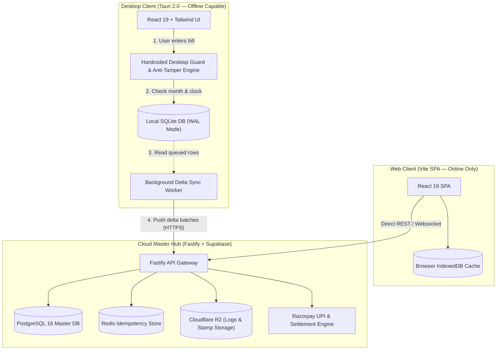
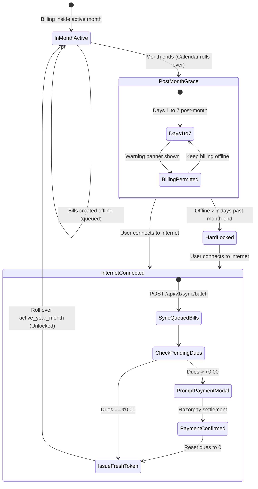

# BillPulse Pro — System Architecture & Engineering Design

BillPulse Pro is an offline-first POS and GST invoicing engine built specifically for Indian retail and wholesale counters. It addresses a real operational reality: thousands of small shops, kirana stores, and distributors still run billing counters on 10-year-old Windows PCs with 2 GB to 4 GB of RAM, connected to flaky broadband or mobile hotspots that drop multiple times a day.

Most modern billing web apps crash or freeze the moment the Wi-Fi drops. Older desktop tools, on the other hand, are difficult to learn, require manual voucher configurations every month, and offer no cloud backup or automated subscription billing.

BillPulse Pro bridges this gap with a **dual-runtime architecture**:
1. An **offline-first desktop app** (built with Tauri 2.0 and embedded SQLite) that keeps billing with sub-millisecond local latency even during week-long network outages.
2. A **cloud-native web app** (React 19 + Fastify + PostgreSQL on Supabase) that gives merchants real-time access across devices whenever an internet connection is available.

---

## Table of Contents

- [1. Product Vision & Hardware Constraints](#1-product-vision--hardware-constraints)
  - [1.1 Target Environments & Merchant Profiles](#11-target-environments--merchant-profiles)
  - [1.2 Why Existing Billing Software Fails at the Counter](#12-why-existing-billing-software-fails-at-the-counter)
  - [1.3 Core Engineering Rules](#13-core-engineering-rules)
- [2. Dual-Runtime System Architecture](#2-dual-runtime-system-architecture)
  - [2.1 High-Level Architecture](#21-high-level-architecture)
  - [2.2 Technology Stack & Rationale](#22-technology-stack--rationale)
  - [2.3 Data Storage Topology (Local vs Cloud)](#23-data-storage-topology-local-vs-cloud)
- [3. The Hardcoded Desktop Guard](#3-the-hardcoded-desktop-guard)
  - [3.1 The 7-Day Post-Month Grace Lock](#31-the-7-day-post-month-grace-lock)
  - [3.2 Monotonic Clock Rollback Protection](#32-monotonic-clock-rollback-protection)
  - [3.3 Verification Logic & State Machine](#33-verification-logic--state-machine)
- [4. Core Workflows & Business Logic](#4-core-workflows--business-logic)
  - [4.1 Collision-Free Monthly Numbering (YYYYMM)](#41-collision-free-monthly-numbering-yyyymm)
  - [4.2 Express POS Billing (F4 Keyboard Workflow)](#42-express-pos-billing-f4-keyboard-workflow)
  - [4.3 Micro-Billing Engine (₹0.50 / ₹1.00 / Monthly Plan)](#43-micro-billing-engine-050--100--monthly-plan)
  - [4.4 Background Delta Sync & Reconnection Flow](#44-background-delta-sync--reconnection-flow)
  - [4.5 Brand Customization Studio (F7) & Catalog (F6)](#45-brand-customization-studio-f7--catalog-f6)
- [5. Database Architecture & Schemas](#5-database-architecture--schemas)
  - [5.1 SQLite Local Database DDL](#51-sqlite-local-database-ddl)
  - [5.2 PostgreSQL Cloud Database DDL](#52-postgresql-cloud-database-ddl)
  - [5.3 Sync Batch Wire Format](#53-sync-batch-wire-format)
  - [5.4 Third-Party Integrations](#54-third-party-integrations)
- [6. Printing & Hardware Acceleration](#6-printing--hardware-acceleration)
  - [6.1 ESC/POS Thermal vs A4/A5 PDF Pipelines](#61-escpos-thermal-vs-a4a5-pdf-pipelines)
  - [6.2 Memory & CPU Budget for 2 GB RAM PCs](#62-memory--cpu-budget-for-2-gb-ram-pcs)
- [7. Cloud Infrastructure & Cost Model](#7-cloud-infrastructure--cost-model)
  - [7.1 Deployment Topology](#71-deployment-topology)
  - [7.2 Monthly Cloud Hosting Projections](#72-monthly-cloud-hosting-projections)
- [8. Security, Payments & GST Compliance](#8-security-payments--gst-compliance)
  - [8.1 Local SQLite Encryption & Transit Security](#81-local-sqlite-encryption--transit-security)
  - [8.2 Razorpay Webhook HMAC Verification](#82-razorpay-webhook-hmac-verification)
  - [8.3 NIC GST e-Invoice Compliance](#83-nic-gst-e-invoice-compliance)
- [Appendix A: 35-Day Sprint Roadmap](#appendix-a-35-day-sprint-roadmap)
- [Appendix B: Architectural Trade-Offs & Decisions](#appendix-b-architectural-trade-offs--decisions)
- [Appendix C: Domain Glossary](#appendix-c-domain-glossary)
- [Local Development & Running Tests](#local-development--running-tests)

---

## 1. Product Vision & Hardware Constraints

### 1.1 Target Environments & Merchant Profiles

We designed the software around three clear merchant profiles:

| Merchant Profile | Hardware Environment | Internet Availability | Billing Model |
| :--- | :--- | :--- | :--- |
| **Kirana, Retail Counters & Agro Stores** | Refurbished Windows 7 / 10 PC (2–4 GB RAM, dual-core CPU) + 58mm/80mm USB thermal printer | Offline for days at a time; connects once or twice a week | **₹0.50** per thermal order receipt |
| **Wholesalers, Traders & Distributors** | Standard office PC (4–8 GB RAM) + A4 Laser / Inkjet printer | Intermittent; bills offline during peak rush, syncs nightly | **₹1.00** per full GST tax invoice (with logo, HSN table, and signature stamp) |
| **Multi-Terminal Franchises & Enterprises** | Modern laptops, tablets, or multi-counter setups | Always-on broadband or 4G/5G | **₹299 / month** flat fee for unlimited billing across desktop and web |

---

### 1.2 Why Existing Billing Software Fails at the Counter

When observing cashiers during peak rush hours (such as Sunday mornings in a grocery store or wholesale mandi):

1. **Mouse navigation kills checkout throughput.** Every second spent grabbing a mouse to click an "Add Item" dropdown slows the line. Billing must be 100% keyboard-driven (`F4` for new bill, arrow keys to select, `Enter` to commit, `F10` or `Ctrl+Enter` to cash out and print).
2. **Cloud-only apps drop out during network blips.** When the local ISP blinks, a web-based POS will spin a loading spinner. If a queue of 15 customers is waiting, the cashier cannot pause checkout to troubleshoot their router.
3. **Legacy desktop software lacks automated cloud sync and backup.** Traditional desktop software keeps data stranded on a single local hard drive. If the hard disk fails, months of invoices are lost. Reconciling month-end tax vouchers often requires hiring outside technicians.
4. **Custom invoice branding shouldn't require code.** Putting a company logo, authorized signature, or dynamic payment QR on an invoice in older tools often requires custom macro coding. BillPulse Pro provides an instant visual canvas (`F7`) where merchants drag-and-drop their logo and rubber stamp, with automatic downscaling for offline printing.

---

### 1.3 Core Engineering Rules

* **Cold start in under 2 seconds, RAM under 60 MB:** On a 2 GB RAM machine, allocating 300+ MB for an Electron runtime causes page swapping and sluggish input. Tauri 2.0 uses the OS webview (WebView2 on Windows) and compiles the local engine in Rust, keeping the installer around 8 MB and memory usage below 50 MB.
* **Local writes never wait for the network:** Every invoice is written to the local SQLite database in Write-Ahead Logging (WAL) mode first. The write commits in `< 3 ms`, the thermal printer starts feeding, and a background worker queues the sync payload asynchronously.
* **Micro-metering that respects payment gateway economics:** Charging a payment gateway fee on an individual ₹0.50 bill makes no sense (gateway fees would eat the entire revenue). Instead, the desktop app accrues micro-charges locally and settles them periodically via a prepaid reserve wallet or a monthly payment link via Razorpay UPI.

---

## 2. Dual-Runtime System Architecture

### 2.1 High-Level Architecture

The platform runs two distinct frontends from a unified component codebase:

```
+-------------------------------------------------------------------------------+
|                       CLIENT LAYER (SHARED FRONTEND)                          |
+-------------------------------------------------------------------------------+
|  [Desktop App: Tauri 2.0]                     [Web App: React 19 + Vite]      |
|  ├── UI: React 19 + Tailwind CSS              ├── UI: React 19 + Tailwind CSS |
|  ├── Local DB: Encrypted SQLite (WAL mode)    ├── Local Cache: IndexedDB      |
|  ├── Native Guard: Compiled Rust binary       └── Connectivity: Online-Only   |
|  │   ├── Enforces YYYYMM numbering                                            |
|  │   ├── Checks monotonic clock rollback                                      |
|  │   └── Blocks billing if >7 days past month                                 |
|  └── Background Sync Worker                                                   |
+-------------------------------------------------------------------------------+
                               │
                               │ HTTPS / TLS 1.3 (Batched JSON Deltas)
                               ▼
+-------------------------------------------------------------------------------+
|                   CLOUD BACKEND & API GATEWAY (FASTIFY)                       |
+-------------------------------------------------------------------------------+
|  [Fastify API Cluster on Node 22+]                                            |
|  ├── Device Binding & JWT Auth (/api/v1/auth)                                 |
|  ├── Batch Ingestion & Dedup Engine (/api/v1/sync/batch)                      |
|  ├── License & Grace Period Evaluator (/api/v1/license/verify)                |
|  └── Razorpay Webhook Handler (/api/v1/webhooks/razorpay)                     |
|           │                                                                   |
|           ├──► PostgreSQL 16 (Supabase) ── Master invoices & merchant ledgers |
|           ├──► Redis 7 ─────────────────── Idempotency keys & rate limits     |
|           ├──► Cloudflare R2 ───────────── Logos, rubber stamps & item photos |
|           └──► Razorpay API ────────────── Dynamic UPI QRs & auto-settlement  |
+-------------------------------------------------------------------------------+
```



---

### 2.2 Technology Stack & Rationale

| Layer | Technology | Why We Selected It |
| :--- | :--- | :--- |
| **Desktop Shell** | [Tauri 2.0](https://v2.tauri.app/) (Rust) | Produces an ~8 MB installer, boots in $< 1\text{ s}$, consumes $< 50\text{ MB}$ RAM, and compiles the license guard into native machine code instead of plain JavaScript. |
| **Shared Frontend** | [React 19](https://react.dev/) + [Vite](https://vite.dev/) + [Tailwind CSS](https://tailwindcss.com/) | Hot-module replacement during development, sub-second builds, and a single responsive UI tree reused across both desktop and web runtimes. |
| **Local Database** | [SQLite 3](https://www.sqlite.org/) (WAL mode + SQLCipher) | Zero-configuration single file. Requires no background Windows service, handles abrupt power cuts safely, and executes indexed queries in under 2 ms. |
| **Cloud Database** | [PostgreSQL 16](https://www.postgresql.org/) via [Supabase](https://supabase.com/) | Reliable relational storage with Row-Level Security (RLS) keeping merchant data isolated per tenant. |
| **API Framework** | [Fastify](https://fastify.dev/) (Node.js TypeScript) | Minimal overhead and built-in JSON schema validation, easily handling 30,000+ requests per second during peak evening sync times. |
| **Asset Storage** | [Cloudflare R2](https://www.cloudflare.com/products/r2/) | S3-compatible bucket with zero egress fees, keeping bandwidth costs flat when thousands of shops sync high-resolution logos and stamps. |
| **Payments** | [Razorpay](https://razorpay.com/) Payment Gateway & UPI | Solid Indian UPI stack supporting dynamic collection QR codes, auto-debit subscriptions, and instant webhook callbacks. |

---

### 2.3 Data Storage Topology (Local vs Cloud)

| Data Asset | Desktop Storage Location | Cloud Storage Location | Sync Protocol |
| :--- | :--- | :--- | :--- |
| **Invoices & Line Items** | Local encrypted file: `C:\ProgramData\BillPulse\data\ledger.sqlite3` | Master `invoices` & `invoice_line_items` tables in PostgreSQL | Background worker reads `WHERE sync_status = 'offline_queued'`, posts to `/api/v1/sync/batch`, and flips status to `synced`. |
| **Company Logo & Signature** | Local disk `C:\ProgramData\BillPulse\assets\` + base64 Data URI in SQLite | Cloudflare R2 bucket (`r2://billpulse-assets/{tenant_id}/`) | Images are compressed on the client to $< 150\text{ KB}$ WebP before disk save and background R2 upload. |
| **License State & Grace Days** | Binary state file `license.guard` + `merchant_profile` table in SQLite | `merchant_profile` table in PostgreSQL | Calling `/api/v1/license/verify` returns a server-signed JWT resetting the 7-day grace window when dues are cleared. |

---

## 3. The Hardcoded Desktop Guard

### 3.1 The 7-Day Post-Month Grace Lock

To balance offline freedom with subscription enforcement, the desktop binary enforces a strict lifecycle rule:

* **During the current month (`YYYY-MM`):** The merchant can bill 100% offline. Every invoice is prefixed with the active month (e.g., `INV-202611-0001`) and queued locally.
* **When the month ends:** In India, merchants and their accountants need time to close the books. The desktop app grants a **7-calendar-day offline grace window**. During Days 1 through 7 of the new month, a non-intrusive banner appears:
  `"Post-month grace period active: 3 days remaining. Please connect to internet to sync."`
* **On Day 8 and beyond:** If the computer has remained offline for more than 7 days after the month ended, a full-screen hard lock engages. No new bills can be generated until the computer is connected to the internet.
* **On Reconnection:** The app automatically pushes all queued offline invoices first. It then checks outstanding dues. If dues are ₹0.00, it unlocks immediately. If dues are pending, it displays a Razorpay payment modal and unlocks the moment the payment webhook confirms.



---

### 3.2 Monotonic Clock Rollback Protection

Because the desktop runs on a user-controlled Windows machine, a user might try to roll back their Windows system clock (e.g., setting the date back from December 10 to November 25) to trick the 7-day grace timer.

To prevent this:
1. Every time the app writes an invoice or runs a heartbeat, it checks `now_unix` against `max_seen_timestamp` stored in the encrypted SQLite database.
2. If `now_unix < max_seen_timestamp - 300` (meaning the clock jumped backward by more than 5 minutes), the guard immediately trips:
   `CLOCK_TAMPERED_CONNECT_INTERNET`
3. Billing is blocked until an internet connection is established and the server confirms the true NTP network time.
4. If the time is valid and moving forward, `max_seen_timestamp` is updated:
   $$\text{max\_seen\_timestamp} = \max(\text{max\_seen\_timestamp}, \text{now\_unix})$$

---

### 3.3 Verification Logic & State Machine

Here is the exact algorithm running inside [`packages/desktop-guard/src/guard.ts`](packages/desktop-guard/src/guard.ts):

```typescript
export function verifyDesktopGuard(
  profile: MerchantProfile,
  nowUnix: number,
  isInternetConnected: boolean
): GuardEvaluationResult {
  // 1. Clock Rollback Check (5-minute tolerance for minor NTP corrections)
  if (nowUnix < profile.max_seen_timestamp - 300) {
    return {
      allowed: false,
      code: 'CLOCK_TAMPERED_CONNECT_INTERNET',
      message: 'System clock moved backward. Connect to internet to re-sync time.'
    };
  }

  const date = new Date(nowUnix * 1000);
  const currentYearMonth = `${date.getUTCFullYear()}-${String(date.getUTCMonth() + 1).padStart(2, '0')}`;
  const isMonthExceeded = currentYearMonth > profile.active_year_month;

  // 2. Compute days elapsed since the active billing month closed
  const activeMonthEndUnix = getEndOfMonthUnix(profile.active_year_month);
  const referenceTimestamp = Math.max(profile.last_synced_at, activeMonthEndUnix);
  const offlineDaysAfterMonthEnd = isMonthExceeded
    ? Math.floor(Math.max(0, nowUnix - referenceTimestamp) / 86400)
    : 0;

  // 3. Offline Mode: Allow up to 7 days grace, hard block on Day 8+
  if (!isInternetConnected) {
    if (isMonthExceeded && offlineDaysAfterMonthEnd > 7) {
      return {
        allowed: false,
        code: 'BLOCKED_OFFLINE_OVER_7_DAYS',
        offlineDays: offlineDaysAfterMonthEnd,
        pendingDuesINR: profile.pending_dues_paise / 100,
        message: 'Offline grace period exceeded (>7 days). Connect internet to continue billing.'
      };
    }

    const remainingGraceDays = isMonthExceeded ? Math.max(0, 7 - offlineDaysAfterMonthEnd) : undefined;

    return {
      allowed: true,
      code: 'OFFLINE_ALLOWED',
      remainingGraceDays,
      offlineDays: isMonthExceeded ? offlineDaysAfterMonthEnd : 0
    };
  }

  // 4. Online Mode: If month has rolled over, ensure past month dues are settled
  if (isMonthExceeded && profile.pending_dues_paise > 0) {
    return {
      allowed: false,
      code: 'PAYMENT_DUE_ON_RECONNECT',
      pendingDuesINR: profile.pending_dues_paise / 100,
      message: `Pending balance of ₹${(profile.pending_dues_paise / 100).toFixed(2)} due for previous month.`
    };
  }

  // 5. All Clear: Advance prefix and unlock
  return {
    allowed: true,
    code: 'UNLOCKED_AND_VERIFIED',
    nextPrefix: `${profile.invoice_prefix}-${currentYearMonth.replace('-', '')}-`
  };
}
```

---

## 4. Core Workflows & Business Logic

### 4.1 Collision-Free Monthly Numbering (YYYYMM)

Invoice numbers must satisfy two hard requirements:
1. They must strictly comply with Indian GST rules (consecutive serial numbering per financial period, max 16 characters).
2. Multiple offline terminals (`D1`, `D2`, `W1`) must never generate the same invoice number while disconnected.

We achieve this with a structured composite key:

$$\text{Format: } \underbrace{\text{INV}}_{\text{Prefix}} - \underbrace{202611}_{\text{YYYYMM}} - \underbrace{\text{D1}}_{\text{Terminal}} - \underbrace{0042}_{\text{Serial}}$$

* **Single-terminal setup:** `INV-202611-0042`
* **Multi-terminal setup:** `INV-202611-D1-0042` (Counter 1) and `INV-202611-D2-0042` (Counter 2)

When the calendar month rolls over to December 2026, the numbering engine automatically starts `INV-202612-D1-0001` without requiring manual voucher sequence resets.

---

### 4.2 Express POS Billing (F4 Keyboard Workflow)

The checkout screen uses a split-screen design:
* **Left Pane (Keyboard Input):** Cashiers navigate using `Tab` and `Enter` through customer mobile, item search, quantity, discount, and payment mode (`Cash`, `UPI`, `Card`, `Credit`).
* **Right Pane (Live WYSIWYG Print Preview):** A live 1:1 view of the invoice renders in real time as items are keyed in, showing itemized rates, HSN codes, and automatic tax splits (CGST + SGST for intrastate sales, IGST for interstate sales).

```
+------------------------------------------+------------------------------------------+
|  F4: NEW BILL   [Customer: 9876543210]   |  LIVE PREVIEW (58mm Thermal / A4 Sheet)  |
+------------------------------------------+------------------------------------------+
| Item Search: [Basmati Rice 1kg      ]    | APEX RETAIL MART                         |
| Qty: [ 2.0 ]  Rate: [ 120.00 ]  GST: [5%]  | GSTIN: 29AABCU9603R1ZM                   |
| Discount: [ 0.00 ]  Tax Split: Intrastate| Invoice: INV-202611-D1-0001              |
+------------------------------------------+ Date: 2026-11-09                         |
| FAST PILLS (F6):                         | ---------------------------------------- |
| [Rice 1kg] [Oil 1L] [Sugar 1kg] [Atta 5k]| 1. Basmati Rice (1kg)   x2.0    Rs 240.00|
| [Tea 250g] [Salt 1kg] [Soap 4pk]         |    CGST (2.5%): Rs 6.00  SGST: Rs 6.00   |
+------------------------------------------+ ---------------------------------------- |
| Total: Rs 252.00   [F10 / Ctrl+Enter: Pay| Subtotal: Rs 240.00   Tax: Rs 12.00      |
| Payment Mode: [ Cash ]  [ UPI QR ]       | GRAND TOTAL: Rs 252.00                   |
+------------------------------------------+------------------------------------------+
```

---

### 4.3 Micro-Billing Engine (₹0.50 / ₹1.00 / Monthly Plan)

BillPulse Pro supports three pricing tiers:

| Tier Code | Fee | Target Document | Settlement Method |
| :--- | :--- | :--- | :--- |
| `PER_ORDER_050` | **₹0.50** | Compact thermal receipt / cash memo | Deducted from prepaid wallet or accrued in local ledger and settled monthly via UPI QR. |
| `PER_INVOICE_100`| **₹1.00** | A4/A5 full GST invoice with logo & stamp | Deducted from prepaid wallet or accrued and settled via Razorpay payment link. |
| `MONTHLY_UNLIMITED`| **₹299/mo** | Unlimited thermal & A4 invoices | Billed monthly via recurring Razorpay payment link or UPI autopay. |

---

### 4.4 Background Delta Sync & Reconnection Flow

When internet connectivity returns:

```
[Desktop Detects Connection]
            │
            ▼
[Query SQLite: SELECT * FROM invoices WHERE sync_status = 'offline_queued' LIMIT 100]
            │
            ▼
[POST /api/v1/sync/batch with UUIDs & Line Items]
            │
            ├──► Cloud PostgreSQL inserts rows in a single ACID transaction
            ├──► Accrues ₹0.50 or ₹1.00 fee per invoice to merchant balance
            │
            ▼
[API responds: { synced_ids: [...], pending_dues_inr: 42.50, license_status }]
            │
            ├──► Local SQLite marks synced_ids as 'synced'
            │
            ├──► If Month Rolled Over AND Pending Dues > ₹0:
            │        Show Razorpay UPI QR modal for ₹42.50
            │        Merchant scans and pays -> Webhook verifies -> Unlocks
            │
            └──► If Dues == ₹0:
                     Issue signed license JWT -> Unlocks immediately
```

---

### 4.5 Brand Customization Studio (F7) & Catalog (F6)

* **Zero-Code Branding (`F7`):** Merchants upload their shop logo and authorized signature stamp. The browser or webview immediately rescales the image to $300 \times 300\text{ px}$ in WebP format ($< 150\text{ KB}$), saving it to SQLite for offline printing and queuing it for upload to Cloudflare R2.
* **Product Catalog (`F6`):** Displays frequently billed items as visual cards or pills with predefined HSN codes, GST percentages, and selling rates. Cashiers can tap or click items to instantly add them to the active invoice.

---

## 5. Database Architecture & Schemas

### 5.1 SQLite Local Database DDL

File: [`packages/database/sqlite/schema.sql`](packages/database/sqlite/schema.sql)

```sql
PRAGMA journal_mode = WAL;
PRAGMA foreign_keys = ON;

-- Merchant Profile & Local License State
CREATE TABLE IF NOT EXISTS merchant_profile (
    tenant_id TEXT PRIMARY KEY,
    company_name TEXT NOT NULL,
    company_address TEXT,
    company_gstin TEXT,
    upi_id TEXT,
    invoice_prefix TEXT NOT NULL DEFAULT 'INV',
    billing_plan TEXT NOT NULL DEFAULT 'PER_ORDER_050',
    logo_data_uri TEXT,
    signature_data_uri TEXT,
    active_year_month TEXT NOT NULL,
    last_synced_at INTEGER NOT NULL,
    max_seen_timestamp INTEGER NOT NULL,
    pending_dues_paise INTEGER NOT NULL DEFAULT 0,
    signed_license_jwt TEXT,
    device_id TEXT NOT NULL,
    terminal_code TEXT NOT NULL DEFAULT 'D1'
);

-- Fast Product Catalog
CREATE TABLE IF NOT EXISTS catalog_items (
    item_id TEXT PRIMARY KEY,
    tenant_id TEXT NOT NULL,
    item_name TEXT NOT NULL,
    hsn_code TEXT,
    selling_rate_paise INTEGER NOT NULL,
    gst_percent REAL NOT NULL DEFAULT 5.0,
    image_data_uri TEXT,
    updated_at INTEGER NOT NULL
);

-- Local Invoices & Sync Queue
CREATE TABLE IF NOT EXISTS invoices (
    invoice_uuid TEXT PRIMARY KEY,
    tenant_id TEXT NOT NULL,
    invoice_number TEXT NOT NULL UNIQUE,
    year_month_prefix TEXT NOT NULL,
    invoice_date TEXT NOT NULL,
    customer_name TEXT NOT NULL,
    customer_phone TEXT,
    customer_gstin TEXT,
    payment_mode TEXT NOT NULL,
    subtotal_paise INTEGER NOT NULL,
    gst_total_paise INTEGER NOT NULL,
    discount_paise INTEGER NOT NULL DEFAULT 0,
    grand_total_paise INTEGER NOT NULL,
    billing_tier TEXT NOT NULL,
    platform_fee_paise INTEGER NOT NULL,
    sync_status TEXT NOT NULL DEFAULT 'offline_queued',
    created_at_unix INTEGER NOT NULL
);

-- Line Items
CREATE TABLE IF NOT EXISTS invoice_line_items (
    line_id TEXT PRIMARY KEY,
    invoice_uuid TEXT NOT NULL REFERENCES invoices(invoice_uuid) ON DELETE CASCADE,
    item_name TEXT NOT NULL,
    qty REAL NOT NULL,
    rate_paise INTEGER NOT NULL,
    gst_percent REAL NOT NULL,
    line_total_paise INTEGER NOT NULL
);

CREATE INDEX IF NOT EXISTS idx_invoices_sync_status ON invoices(sync_status);
CREATE INDEX IF NOT EXISTS idx_invoices_year_month ON invoices(year_month_prefix);
CREATE INDEX IF NOT EXISTS idx_catalog_items_tenant ON catalog_items(tenant_id);
```

---

### 5.2 PostgreSQL Cloud Database DDL

File: [`packages/database/postgres/schema.sql`](packages/database/postgres/schema.sql)

```sql
CREATE EXTENSION IF NOT EXISTS "uuid-ossp";

CREATE TABLE IF NOT EXISTS merchant_profile (
    tenant_id UUID PRIMARY KEY DEFAULT uuid_generate_v4(),
    company_name VARCHAR(255) NOT NULL,
    company_address TEXT,
    company_gstin VARCHAR(15),
    upi_id VARCHAR(100),
    invoice_prefix VARCHAR(10) NOT NULL DEFAULT 'INV',
    billing_plan VARCHAR(30) NOT NULL DEFAULT 'PER_ORDER_050',
    logo_url TEXT,
    signature_url TEXT,
    active_year_month VARCHAR(7) NOT NULL,
    last_synced_at BIGINT NOT NULL DEFAULT EXTRACT(EPOCH FROM NOW())::BIGINT,
    pending_dues_paise BIGINT NOT NULL DEFAULT 0,
    wallet_balance_paise BIGINT NOT NULL DEFAULT 0,
    created_at TIMESTAMPTZ NOT NULL DEFAULT NOW()
);

CREATE TABLE IF NOT EXISTS invoices (
    invoice_uuid UUID PRIMARY KEY,
    tenant_id UUID NOT NULL REFERENCES merchant_profile(tenant_id) ON DELETE CASCADE,
    device_id VARCHAR(128),
    invoice_number VARCHAR(64) NOT NULL,
    year_month_prefix VARCHAR(6) NOT NULL,
    invoice_date DATE NOT NULL,
    customer_name VARCHAR(255) NOT NULL,
    customer_phone VARCHAR(20),
    customer_gstin VARCHAR(15),
    payment_mode VARCHAR(20) NOT NULL,
    subtotal_paise BIGINT NOT NULL,
    gst_total_paise BIGINT NOT NULL,
    discount_paise BIGINT NOT NULL DEFAULT 0,
    grand_total_paise BIGINT NOT NULL,
    billing_tier VARCHAR(30) NOT NULL,
    platform_fee_paise BIGINT NOT NULL,
    sync_status VARCHAR(20) NOT NULL DEFAULT 'synced',
    created_at_unix BIGINT NOT NULL,
    synced_at TIMESTAMPTZ NOT NULL DEFAULT NOW(),
    UNIQUE (tenant_id, invoice_number)
);

CREATE TABLE IF NOT EXISTS invoice_line_items (
    line_id VARCHAR(64) PRIMARY KEY,
    invoice_uuid UUID NOT NULL REFERENCES invoices(invoice_uuid) ON DELETE CASCADE,
    item_name VARCHAR(255) NOT NULL,
    qty NUMERIC(10,3) NOT NULL,
    rate_paise BIGINT NOT NULL,
    gst_percent NUMERIC(4,2) NOT NULL,
    line_total_paise BIGINT NOT NULL
);

CREATE INDEX IF NOT EXISTS idx_cloud_invoices_lookup ON invoices(tenant_id, year_month_prefix);
ALTER TABLE merchant_profile ENABLE ROW LEVEL SECURITY;
ALTER TABLE invoices ENABLE ROW LEVEL SECURITY;
ALTER TABLE invoice_line_items ENABLE ROW LEVEL SECURITY;
```

---

### 5.3 Sync Batch Wire Format

```json
{
  "tenant_id": "tenant-demo-001",
  "device_id": "HWID-WIN-882194",
  "terminal_code": "D1",
  "client_timestamp": 1794220800,
  "invoices": [
    {
      "invoice_uuid": "550e8400-e29b-41d4-a716-446655440001",
      "tenant_id": "tenant-demo-001",
      "invoice_number": "INV-202611-D1-0001",
      "year_month_prefix": "202611",
      "invoice_date": "2026-11-09",
      "customer_name": "Ramesh Kumar",
      "customer_phone": "9876543210",
      "customer_gstin": null,
      "payment_mode": "UPI",
      "subtotal_paise": 24000,
      "gst_total_paise": 1200,
      "discount_paise": 0,
      "grand_total_paise": 25200,
      "billing_tier": "PER_ORDER_050",
      "platform_fee_paise": 50,
      "sync_status": "offline_queued",
      "created_at_unix": 1794220800,
      "items": [
        {
          "line_id": "LINE-01",
          "invoice_uuid": "550e8400-e29b-41d4-a716-446655440001",
          "item_name": "Basmati Rice (1kg)",
          "qty": 2.0,
          "rate_paise": 12000,
          "gst_percent": 5.0,
          "line_total_paise": 25200
        }
      ]
    }
  ]
}
```

---

### 5.4 Third-Party Integrations

| Integration | Provider | Method | Rationale |
| :--- | :--- | :--- | :--- |
| **Payment Gateway & UPI** | [Razorpay](https://razorpay.com/) | Orders REST API + Webhooks (`x-razorpay-signature`) | Settle ₹0.50 / ₹1.00 accrued balances and ₹299 monthly plans via UPI. |
| **Cloud Database** | [Supabase](https://supabase.com/) | PostgreSQL 16 connection pooling | Managed relational master with automated daily backups. |
| **Asset CDN** | [Cloudflare R2](https://www.cloudflare.com/products/r2/) | S3-compatible API | Zero egress bandwidth costs for logos and stamps. |
| **e-Invoicing (B2B)** | [NIC GST Portal](https://www.nic.gov.in/project/gst-e-invoice/) | GSP REST API (`einvoice1.gst.gov.in`) | Automated IRN and signed QR generation for wholesale tax invoices. |

---

## 6. Printing & Hardware Acceleration

### 6.1 ESC/POS Thermal vs A4/A5 PDF Pipelines

Printing cannot depend on heavy headless browser rendering (like Puppeteer), which easily allocates 300+ MB of RAM and freezes an older PC. Instead, we use two lightweight pipelines:

1. **Compact Thermal Receipts (58mm / 80mm USB Thermal Printers):**
   * Generated as raw ESC/POS byte buffers (initialization `ESC @`, text alignment, font size, paper cut `GS V 66 0`).
   * Sent directly to the local Windows printer port (`\\.\USB001` or raw spooler API).
   * **Latency:** Under 50 ms. Zero PDF spooling overhead.
2. **Full GST Tax Invoices (A4 / A5 Laser & Inkjet Printers):**
   * Formatted using clean CSS `@media print` rules rendered directly by the OS webview.
   * Includes high-resolution SVG barcode, shop logo, HSN summary table, and digital stamp.
   * **Latency:** Under 300 ms.

---

### 6.2 Memory & CPU Budget for 2 GB RAM PCs

| Performance Metric | Budget Target (Legacy 2 GB PC) | Modern PC (8 GB+ RAM) | How We Guarantee It |
| :--- | :--- | :--- | :--- |
| **Installer Size** | `< 10 MB` | Instant Web Load | Tauri 2.0 binary with no bundled Node/Chromium runtime. |
| **Idle Memory (RAM)** | `35 MB – 55 MB` | `60 MB – 90 MB` | Single embedded SQLite instance; zero background daemons. |
| **Invoice Commit Time** | `< 15 ms` local write | `< 5 ms` local write | SQLite Write-Ahead Logging (`PRAGMA synchronous = NORMAL;`). |

---

## 7. Cloud Infrastructure & Cost Model

### 7.1 Deployment Topology

The cloud backend is designed to run efficiently on low-cost compute:
* Fastify API instances running in Docker containers behind an Nginx reverse proxy.
* Redis handles sync deduplication and rate limiting.
* Supabase provides managed PostgreSQL with connection pooling.
* Cloudflare R2 serves all merchant assets with zero egress bandwidth charges.

---

### 7.2 Monthly Cloud Hosting Projections

| Growth Stage | Active Shops | Monthly Invoices Synced | Database (Supabase) | Asset Storage (R2) | API Compute & Redis | Total Monthly Cloud Cost |
| :--- | :--- | :--- | :--- | :--- | :--- | :--- |
| **Stage 1: MVP** | 100 | ~150,000 | $0 – $25 | $0 (Free tier) | $7 (1 vCPU VPS) | **~$7 – $32 / month** |
| **Stage 2: Growth** | 1,000 | ~1.5 Million | $25 – $50 | ~$1.50 | $24 (2 vCPU + Redis) | **~$50 – $75 / month** |
| **Stage 3: Scale** | 10,000 | ~15 Million | $150 (Read replicas) | ~$15 | $80 (Load-balanced) | **~$245 / month** |

---

## 8. Security, Payments & GST Compliance

### 8.1 Local SQLite Encryption & Transit Security

* **SQLCipher AES-256:** The local desktop SQLite database is encrypted at rest using an encryption key tied to the machine's hardware UUID. Copying the `.sqlite3` file to another computer results in an unreadable file.
* **TLS 1.3:** All cloud sync communication occurs over HTTPS with TLS 1.3 and certificate validation.

---

### 8.2 Razorpay Webhook HMAC Verification

All incoming payment webhooks are verified using timing-safe HMAC-SHA256 signatures before updating balances:

```typescript
// packages/api/src/server.ts
export function verifyRazorpaySignature(
  rawBody: string,
  signature: string,
  secret: string
): boolean {
  if (!rawBody || !signature || !secret) return false;
  try {
    const expected = createHmac('sha256', secret).update(rawBody).digest('hex');
    const expectedBuf = Buffer.from(expected, 'utf8');
    const actualBuf = Buffer.from(signature, 'utf8');
    if (expectedBuf.length !== actualBuf.length) return false;
    return timingSafeEqual(expectedBuf, actualBuf);
  } catch {
    return false;
  }
}
```

---

### 8.3 NIC GST e-Invoice Compliance

Every invoice payload stores standard GSTIN fields matching the CBIC schema:
* 15-character Supplier & Buyer GSTIN validation.
* HSN/SAC code tracking per line item.
* Explicit CGST, SGST, and IGST breakdowns.
* Ready for one-click JSON export to the official [NIC GST e-Invoice Portal](https://www.nic.gov.in/project/gst-e-invoice/) to generate an IRN and signed QR code.

---

## Appendix A: 35-Day Sprint Roadmap

A practical 7-week delivery plan for a two-engineer team (1 Full-Stack + 1 Desktop/Frontend):

| Sprint & Timeline | Milestone | Key Deliverables |
| :--- | :--- | :--- |
| **Week 1 (Days 1–7)** | Core UI & Schemas | Monorepo setup, SQLite and PostgreSQL tables, F4 split-screen invoice builder with keyboard navigation. |
| **Week 2 (Days 8–12)** | Catalog & Branding Studio | Client-side image compression ($< 150\text{ KB}$), local asset storage, Cloudflare R2 uploads, and F6 catalog pills. |
| **Week 3–4 (Days 13–20)** | Desktop Packaging & Guard | Tauri 2.0 shell, YYYYMM numbering generator, monotonic clock anti-tamper check, and 7-day post-month lock. |
| **Week 5 (Days 21–26)** | Cloud Sync API | Fastify batch ingestion (`POST /api/v1/sync/batch`), Redis idempotency checks, and reconnection auto-drain. |
| **Week 6 (Days 27–31)** | Micro-Billing & Payments | Per-bill fee metering (₹0.50 / ₹1.00), Razorpay UPI QR checkout, and signed license unlock webhook. |
| **Week 7 (Days 32–35)** | Thermal Print & Low-RAM QA | Direct ESC/POS thermal printing (58mm/80mm), A4 print layouts, and stress tests on 2 GB RAM Windows VMs. |

---

## Appendix B: Architectural Trade-Offs & Decisions

| Decision Area | Chosen Path | What We Rejected | Real-World Reason |
| :--- | :--- | :--- | :--- |
| **Desktop Shell** | **Tauri 2.0 (Rust)** | Electron or .NET WPF | Electron installers are 120+ MB and idle at 250 MB RAM, causing thrashing on old 2 GB shop PCs. Tauri idles under 50 MB and compiles the license guard into native binary. |
| **Local Database** | **Embedded SQLite WAL** | Local MySQL / Postgres server | Running a background database daemon on client Windows machines leads to port conflicts, antivirus blocks, and high RAM usage. SQLite is zero-maintenance. |
| **Micro-Billing Settlement** | **Accrued Ledger + UPI QR** | Gateway call on every ₹0.50 bill | Payment gateways charge minimum fixed transaction fees and require active internet. Batching fees locally and settling via UPI monthly works completely offline. |
| **Numbering Scheme** | **`INV-YYYYMM-TERM-SEQ`** | Central server auto-increment | You cannot ask a cloud server for an incrementing number when your shop has no internet. Generating composite keys locally guarantees zero collisions. |

---

## Appendix C: Domain Glossary

* **Month Prefix (`YYYYMM`):** The mandatory 6-digit year-month string automatically embedded in every invoice (e.g., `202611` for November 2026).
* **7-Day Post-Month Grace:** The hardcoded policy allowing a desktop terminal to bill offline for up to 7 calendar days after a month closes before requiring an internet sync.
* **Offline Sync Queue:** Local SQLite table buffer containing invoices where `sync_status = 'offline_queued'`, which drains when internet reconnects.
* **Monotonic High-Water Mark:** The highest verified Unix timestamp stored on disk (`max_seen_timestamp`), used to block OS clock rollbacks.
* **Micro-Billing Balance:** The accrued fee balance (in paise) metering ₹0.50 per order bill or ₹1.00 per full tax invoice.

---

## Local Development & Running Tests

### Prerequisites
* Node.js `v20.0.0+` (tested on `v24.15.0`)
* Git `v2.40.0+`

### 1. Run the Hardcoded Guard Test Suite

The test suite validates all 7 offline guard scenarios, the monotonic clock rollback check, and the numbering engine with zero external dependencies:

```bash
npm test
```

### 2. File Organization

```
billpulse-pro/
├── README.md                      # Architecture & Engineering Design Spec
├── LICENSE                        # MIT License
├── package.json                   # Monorepo workspaces & test runner
├── packages/
│   ├── shared/                    # Shared TypeScript interfaces & types
│   │   └── src/types.ts
│   ├── desktop-guard/             # Anti-tamper & 7-day post-month grace engine
│   │   ├── src/guard.ts
│   │   └── tests/guard.test.mjs   # Automated test suite (10/10 passing)
│   ├── database/                  # Complete DDLs & seed data
│   │   ├── sqlite/schema.sql
│   │   ├── postgres/schema.sql
│   │   └── seed/seed.sql
│   └── api/                       # Fastify delta sync & Razorpay verifier
│       └── src/server.ts
```
