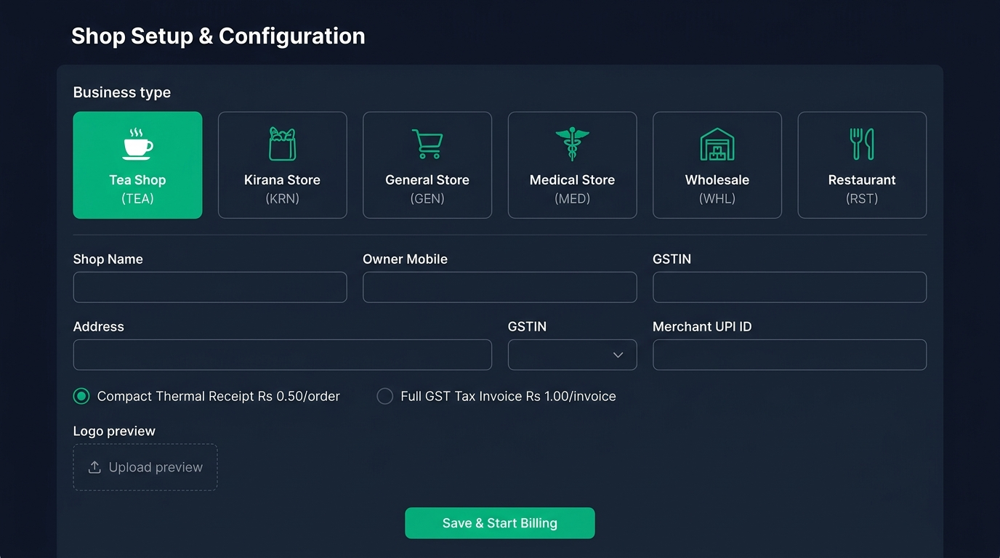
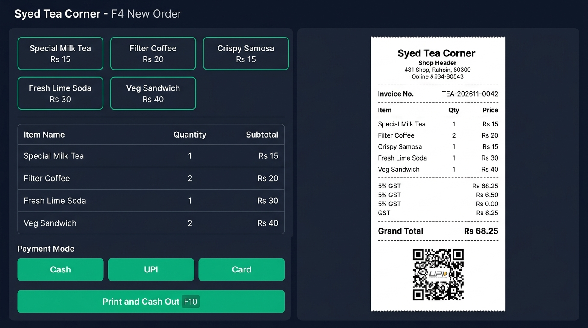
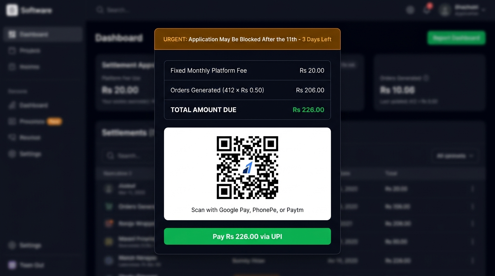
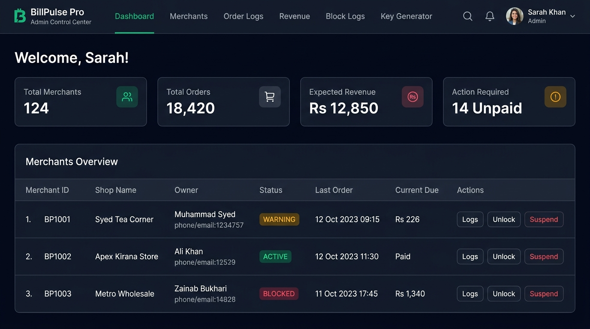

# Statement of Work (SOW) — BillPulse Pro Billing Platform

**Project Name:** BillPulse Pro (Offline-First Desktop POS & Cloud Admin Control Center)  
**Version:** 1.0  
**Target Team:** 2 Developers (1 Full-Stack / Systems Engineer + 1 Frontend / Desktop Engineer)  
**Timeline:** Clickable Skeleton (Immediate / 1–2 Days) | Full Production Build (22 Working Days)

---

## 1. Executive Summary & Objective

BillPulse Pro is a standardized, two-application billing ecosystem designed for small and mid-sized retail counters (Tea Shops, Kirana Stores, General Stores, Pharmacies, Restaurants, and Wholesalers):

1. **Application 1 — Merchant Desktop App (Offline-First):** A fast, lightweight desktop counter app (Tauri 2.0 + SQLite) with 3–4 setup screens and 1 billing screen. Merchants select their business type once, start billing in under 2 minutes without accounting jargon or complex vouchers, and work reliably offline or online.
2. **Application 2 — Web Admin Control Panel (Browser-Based):** A centralized online dashboard giving the platform owner complete visibility over every merchant terminal, real-time order counts, accrued month-end dues, Razorpay collections, automated warning/block logs, and 1-click access to grant, suspend, or revoke licenses.

---

## 2. Visual Overview (UI Mockups)

### Shop Setup & Business Presets (Desktop)

### Express POS & Live Receipt (Desktop F4)

### Month-End Settlement & Grace/Block Overlay (Desktop)

### Web Admin Control Center (Platform Owner)

---

## 3. Detailed Scope of Work

### 3.1 Deliverable A: Desktop POS Application (5 Screens)

| Screen | Functional Scope | Technical Behavior |
| :--- | :--- | :--- |
| **1. License Activation** | First-time setup using Serial Number, Activation Key, and Merchant Mobile. | Generates hardware fingerprint (`device_id` from Motherboard/CPU) and locks license to that PC. |
| **2. Shop Setup & Presets** | Business-type selector (**Tea Shop**, **Kirana**, **General**, **Medical**, **Wholesale**, **Restaurant**, **Bakery**, **Stationery**, **Hardware**, **Custom**), Shop Name, Address, GSTIN, Merchant UPI ID, Logo & Stamp upload, Prefix (`TEA`, `KRN`, `WHL`). | Auto-loads curated catalog items, default GST slabs, and invoice prefix based on business type. Compresses images client-side to $<150\text{ KB}$ WebP. |
| **3. Product Catalog (`F6`)** | Visual item grid showing rate (₹), GST %, and HSN code. | Instant add/edit/delete stored in local encrypted SQLite (`catalog_items`). |
| **4. Express POS (`F4`)** | Split-screen counter billing: quick item pills + keyboard entry on left; live 1:1 58mm/80mm thermal or A4 preview with customer UPI QR on right. | Commits invoice locally in $<3\text{ ms}$ (SQLite WAL mode) even without internet. Accrues platform fee (`₹0.50` or `₹1.00`) per order. |
| **5. Month-End Settlement** | Auto-displays on month rollover showing exact dues: `₹20 base + (Orders × Rate)` with Razorpay Dynamic UPI QR. | Enforces the **7th-to-11th Policy**: Day 1–7 green reminder; Day 7–11 orange block warning; Day 11+ hard lock until paid. |

### 3.2 Deliverable B: Hardcoded Guard & Postpaid Metering Engine

* **100% Postpaid Model (Zero Prepaid Wallet):** Merchants pay nothing upfront. Every generated bill accrues `₹0.50` (compact thermal order) or `₹1.00` (full GST tax invoice) plus a fixed `₹20.00/month` base platform fee.
* **Grace & Block Timeline (7th → 11th → Block):**
  * **Days 1–7 of new month:** Soft green reminder banner; billing remains unlocked.
  * **Days 7–11 of new month:** Urgent orange warning on every launch: *"Your application may be blocked after the 11th."* Billing remains open.
  * **Day 11+ of new month:** **Hard Block.** New order creation is disabled until month-end dues are settled via Razorpay UPI.
* **Anti-Tamper Clock Guard:** Monotonic timestamp high-water mark (`max_seen_timestamp`) detects OS clock rollbacks (>300 seconds) and locks billing until online verification.

### 3.3 Deliverable C: Web Admin Control Panel (6 Screens)

| Admin Screen | Functional Scope |
| :--- | :--- |
| **1. Global Dashboard** | Live KPIs: Total Merchants, Active Shops, Warning Shops (Days 7–11), Blocked Shops (Day 11+), Total Orders This Month, Expected vs. Collected Revenue. |
| **2. Merchant Registry** | Search by shop name, mobile, or serial #. Filter by `ALL`, `UNPAID`, `WARNING`, `BLOCKED`, `ACTIVE`. Actions: `View Logs`, `Unlock / Grant`, `Suspend`, `Revoke`. |
| **3. Order Logs Drill-Down** | Inspect every bill created by a merchant (invoice #, timestamp, items, payment mode, total, platform fee accrued) + WhatsApp reminder trigger. |
| **4. Revenue & Reports** | Separate tracking for ₹20 base subscriptions vs. per-order fees, verified Razorpay webhook transaction list, and CSV export. |
| **5. Block & Warning Logs** | Full chronological audit trail of Day 7 warnings, Day 11 lockouts, Razorpay unblocks, and manual admin overrides. |
| **6. License Key Generator** | 1-click generation of Serial Numbers (`BP-2026-XXXX-XXXX`) and Activation Keys (`ACT-XXXX-XXXX-XXXX`) bound to `₹0.50` or `₹1.00` plan tiers. |

### 3.4 Deliverable D: Cloud API, Database & Razorpay Webhooks

* **Cloud Sync API (Fastify + TypeScript):** Batch ingestion endpoint (`/api/v1/sync/batch`) with idempotent UUID deduplication.
* **Razorpay Settlement Pipeline:** Dynamic QR generation + timing-safe HMAC-SHA256 webhook verification (`payment.captured`) triggering automatic counter unlock within 2 seconds.
* **Databases:** Local SQLite (WAL + SQLCipher AES-256) on Desktop + Cloud PostgreSQL 16 (Supabase with Row-Level Security) for Master Admin control.

---

## 4. Explicitly Out of Scope

To keep delivery fast (22 days) and the product ultra-simple for shopkeepers, the following are **excluded** from v1.0:
* Double-entry accounting vouchers (Contra, Journal, Debit/Credit Notes).
* Prepaid wallet top-up flows (100% postpaid month-end settlement only).
* Complex multi-godown warehouse transfer or manufacturing BOM modules.
* Mobile native Android/iOS apps (Desktop POS + Browser Admin only).

---

## 5. Skeleton vs. Production Delivery Schedule

### Phase 0: Clickable Skeleton Prototype (1–2 Days — Completed!)
* **Purpose:** Visual walkthrough of all 5 Desktop screens and 6 Admin screens with live interactive business presets, receipt math, policy testers, and key generator.
* **Included Ready File:** `apps/skeleton/index.html` (opens directly in any browser with zero setup).

### Phase 1–5: Full Production Build (22 Working Days — 2 Developers)

| Sprint | Days | Developer 1 (Backend, DB, Guard, Razorpay) | Developer 2 (Desktop Tauri, POS UI, Admin Web) | Milestone Sign-Off |
| :--- | :--- | :--- | :--- | :--- |
| **Sprint 1** | **Days 1–4** | SQLite WAL schema, Tauri Rust shell, hardware fingerprint binding, activation API. | Desktop Screen 1 (Activation) + Screen 2 (Shop Setup & Presets). | App installs on Windows, activates license, configures shop. |
| **Sprint 2** | **Days 5–8** | Guard engine (Day 7 warn, Day 11 block), monotonic clock protection, YYYYMM numbering. | Desktop Screen 3 (Catalog F6) + Screen 4 (Split-Screen Express POS F4). | 100% offline billing works; guard blocks tampered clocks. |
| **Sprint 3** | **Days 9–12** | Fastify sync API, Supabase PostgreSQL setup, background offline sync worker. | ESC/POS 58mm/80mm USB thermal printing, A4 CSS print, Screen 5 (Settlement popup). | Offline bills sync to cloud; thermal receipts print cleanly. |
| **Sprint 4** | **Days 13–16** | Razorpay UPI QR API, HMAC webhook unblocker, ₹20 + order metering ledger. | Admin Screen 1 (Dashboard) + Admin Screen 2 (Merchant Registry & Grant/Revoke). | Live Razorpay settlement unlocks desktop in < 2s. |
| **Sprint 5** | **Days 17–20** | Admin audit APIs (order logs, block logs, license key generator). | Admin Screens 3, 4, 5, 6 (Order Logs, Revenue, Block Logs, Key Generator). | Complete Admin Web Panel connected to live database. |
| **QA & Release** | **Days 21–22** | Low-spec 2 GB RAM Windows VM stress testing, security & webhook end-to-end audit. | Thermal printer compatibility QA (Epson, TVS, Xprinter), production installer packaging. | Signed Windows `.exe`/`.msi` + deployed Admin Panel. |

---

## 6. Acceptance Criteria

1. **Offline Resilience:** Desktop app creates, prints, and saves 50 consecutive bills with Wi-Fi disconnected on a 2 GB RAM Windows PC without freezing.
2. **Preset Simplicity:** Switching between "Tea Shop" and "Kirana Store" during setup takes under 60 seconds and loads accurate default items and prefixes.
3. **Grace & Block Accuracy:** Guard permits billing on Days 1–7, displays the mandatory warning on Days 7–11, and strictly prevents billing on Day 11+ until payment is confirmed.
4. **Instant Unlock:** Scanning and paying the Razorpay QR code automatically unlocks the desktop terminal within 5 seconds of webhook receipt.
5. **Admin Visibility:** Admin Web Panel accurately reflects synced orders, total dues (`₹20 + orders × fee`), and enforces remote `Suspend` / `Unlock` actions on next sync.
